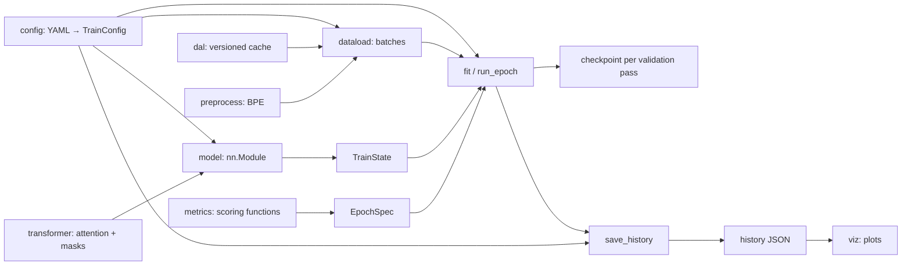

# Dawnshard

**A top-down–designed ML infrastructure library.**

Dawnshard is an ML stack built from first principles and engineered like a real
codebase. Every piece is typed down to tensor shapes, tested, linted,
containerized, and documented with the reasoning behind it.

Most ML code grows bottom-up: a script becomes a notebook becomes a tangle of
globals. Dawnshard goes the other way. Infra is *designed*, with clean seams between
configuration, state, and computation, and this README explains why each seam sits
where it does.

The long-term goal is to build toward **Constitutional AI and RLHF** on top of
this foundation. The training loop, observability, and reproducibility primitives
here are the groundwork for that.

______________________________________________________________________

## Why the name

In Brandon Sanderson's Cosmere, a **Dawnshard** is one of the ancient Commands: a fragment of Adonalsium, the god whose power
shattered into the Shards that now shape every world. Dawnshards are not
weapons or artifacts; they are *access*.

The library's name is a reminder to build the infrastructure that lets humans reach for
that kind of power responsibly.

______________________________________________________________________

## A training run in one screen

Here is a complete classification run with a `model`, `train_loader`, and
`val_loader`. The loaders yield `(input, target)` tuples, and the model produces
class logits. The loop itself has no dataset or model class baked in.

```python
train_state = TrainState(
    model=model.to(device=DEVICE),
    optimizer=torch.optim.Adam(params=model.parameters(), lr=1e-3),
    criterion=nn.CrossEntropyLoss(),
)
epoch_spec = EpochSpec(
    device=DEVICE,
    metrics_type=ClassificationMetrics,
    calculate_metrics=calculate_metrics,
    accumulate_metrics=accumulate_metrics,
    reduce_metrics=reduce_metrics,
)
history = fit(
    state=train_state,
    epoch_spec=epoch_spec,
    train_loader=train_loader,
    val_loader=val_loader,
    fit_config=FitConfig(
        num_epochs=15,
        val_epoch_list=[5, 10, 15],
        train_seed=random.getrandbits(32),
        val_seed=VAL_SEED,
        test_seed=TEST_SEED,
    ),
)
```

Four objects, three jobs:

- `TrainState` is the state: the model, the optimizer, the loss, and an optional
  scheduler.
- `EpochSpec` and `FitConfig` are the policy. `EpochSpec` says which device, how to
  score a batch, and what to watch. `FitConfig` says how many epochs, which ones
  validate, which seeds, and when to stop early.
- `fit` is the mechanism, a function over the three. It returns one `EpochRecord` per
  epoch, with the machine's CPU, RAM, and GPU usage, and checkpoints the state after
  every validation pass.

That is the entire API. The rest of this page explains why it is built this way.

______________________________________________________________________

## Separate state, policy, and mechanism

This is the principle the whole repo hangs on, and the part I am proudest of.

Operating-systems people have a name for it: **separation of policy and mechanism**,
from the Hydra kernel in 1974. Mechanism is the code that does the work. Policy is
the set of decisions about how. Keep them apart and you can change either without
touching the other. JAX and Flax add the third piece, **explicit state**: the caller
passes the model and optimizer in, rather than hiding them in a trainer instance.
Flax even calls its struct `TrainState`.

Dawnshard applies that split to a PyTorch training loop. State, policy, and mechanism
are visible at the call site, so changing a dataset or model does not require a new
loop.

### State: `TrainState`

Defined in [model.py](app/src/training/dataclass/model.py). A dataclass with four
fields: `model`, `optimizer`, `criterion`, and `scheduler`. It holds the caller-owned
objects the loop changes: model parameters, optimizer state, and an optional
scheduler. A checkpoint saves their `state_dict`s through
[`checkpoint`](app/src/training/train/checkpoint.py) and restores them through
[`load`](app/src/training/train/checkpoint.py). `fit` writes one after every
validation pass. The criterion is supplied again by the caller; the checkpoint does
not save it.

### Policy: `EpochSpec`

Same file. It holds `device`, a `Metrics` type, the three functions that score a
batch and reduce an epoch, and two optional probes. The loop reads it and never
writes to it. Supply `Metrics` and the functions in
[loss_only_metrics.py](app/src/training/metrics/loss_only_metrics.py) to use the same
loop for a regressor. Set `train_probe` to capture gradient norms. Nothing in
`EpochSpec` names the model or dataset it will drive.

`FitConfig`, in [config.py](app/src/training/dataclass/config.py), is the other
half of the policy: `num_epochs`, the val and test seeds, and optional `train_seed`,
`val_epoch_list`, `epoch_start`, `run_uuid`, and `early_stopping`. `fit` and
`profiled_fit` read those fields and never write to them. A `val_epoch_list` of
`None` validates every epoch, and an empty one is rejected when the config is built,
since a run that never validates would never checkpoint.

`FitConfig` is the `fit` section of a `TrainConfig`, the root of a run's YAML file
under [app/src/config/](app/src/config/). `fit` never sees the other sections:
`model`, `optimizer`, `scheduler`, `dataloader`, and `data`. The entry point in
[run/](app/src/training/run/) builds the model, the `TrainState`, and the loaders from
them with `build_optimizer` and `build_scheduler` in
[optim.py](app/src/training/train/optim.py). A YAML leaves `train_seed` out, so the
entry point draws a fresh one for each run, writes it and the `run_uuid` into the
config, and hands the whole config to `save_history` after `fit` returns, so the
history file holds every section, `model` and `data` included.

### Mechanism: the functions

Defined in [train_loop.py](app/src/training/train/train_loop.py). Every step has the
same signature:

```python
Batch = tuple[Tensor, Tensor]
StepFn = Callable[["TrainState", "EpochSpec", Batch, int, int, Optional[int]], "Metrics"]
```

State in, policy in, data in, metrics out. The trailing ints are the epoch, the
batch's index, and the seed of the pass, passed through for probes: `val_seed` on a
validation pass, `None` on a training pass.

`train_step` and `eval_step` are the two `StepFn`s. `run_epoch` walks a loader with
whichever one it is handed, `fit` runs the epochs, checkpoints after each validation
pass, and returns the records, and
`profiled_fit` does the same with a profiler on the epochs you pick. None of these
functions owns persistent training state; they change the objects inside `TrainState`
and return metrics or epoch records.

### What that buys you

- **One loop for train and eval.** `run_epoch` takes the step as an argument, so
  `fit` hands it `train_step` for training and `eval_step` for validation. The same
  loop body switches the model's mode, accumulates, and reduces for both.
- **Tests need no `DataLoader`.** `run_epoch` only iterates its loader, so
  [test_train_loop.py](app/tests/test_train_loop.py) passes it a plain list of
  `(input, target)` tuples.
- **The loop has no trainer instance to inspect.** A step's signature names its
  inputs, and [train_loop.py](app/src/training/train/train_loop.py) shows when the
  optimizer steps, metrics accumulate, and probes run.
- **Every piece is replaceable alone.** The MNIST CNN in
  [mnist.py](app/src/training/model/mnist.py) and the AG News transformer in
  [ag_news_classifier.py](app/src/training/model/ag_news_classifier.py) call the same
  `fit`. What changes between them is what goes in: the model, the metrics, a probe,
  and the data. `profiled_fit` changed the mechanism instead, reusing `train_step` and
  `eval_step` untouched.

______________________________________________________________________

## How it compares

Every training framework stores the same three things somewhere. The difference is
which object owns each one, and therefore what you edit when one of them changes.

### Where each framework keeps state, policy, and mechanism

| Framework | State | Policy | Mechanism | To change what a step does |
|---|---|---|---|---|
| Keras | the `keras.Model`: `compile` stores the optimizer, loss, and metrics on it | `compile` and `fit` arguments | `Model.fit`, which calls `Model.train_step` | override `train_step` in a `Model` subclass |
| PyTorch Lightning | the `LightningModule`, an `nn.Module` that also returns its optimizers from `configure_optimizers` | `Trainer` flags | the `Trainer` loop, calling the module's `training_step` | edit `training_step` on the model class |
| Hugging Face `Trainer` | the `Trainer` instance, which holds the model, optimizer, and scheduler | `TrainingArguments` | the `Trainer` loop | pass `compute_loss_func` for a new loss; subclass `Trainer` for any other change to the loop |
| Flax | an explicit `TrainState`; `apply_gradients` returns a new one | yours to write | yours to write | write your own step |
| Dawnshard | `TrainState`, holding caller-owned PyTorch objects | `EpochSpec` | `fit`, `run_epoch`, `train_step`, `eval_step` | pass a different `criterion`, metric function, or probe; any other change is a new step function |

Keras, Lightning, and Hugging Face each make one class the home for at least two of
the three: the model class holds the step, or the trainer class holds the state and
the loop. Flax keeps state explicit and leaves the loop to you. Dawnshard keeps
Flax's explicit state and ships the loop as plain functions, so each concern is its
own argument at the call site.

### What the split buys over a trainer class

- **A change touches the argument that owns it.** The four entry points in
  [model/](app/src/training/model/), for a CNN, a transformer classifier, a
  masked-token predictor, and a translator, all pass the same `nn.CrossEntropyLoss()`. What
  separates their runs is the `Metrics` family and the probe in `EpochSpec`. None of
  them subclasses anything from `train/`.
- **Every extension point is a field you can read.** Hugging Face's
  `TrainerCallback` defines 16 events, and its callbacks are read-only apart from the
  `TrainerControl` flags they return. `EpochSpec` holds five callables, three metric
  functions and two probes, and `grep epoch_spec. train_loop.py` lists every line
  that calls one.
- **The model stays a plain `nn.Module`.** Lightning's `Trainer` fits a
  `LightningModule`, and Keras keeps the optimizer on the model. Every model in
  [model/](app/src/training/model/) subclasses `nn.Module` and nothing else, so
  [a model test](app/tests/test_ag_news_classifier.py) calls the classifier's forward
  pass directly, with no loop around it.
- **A sweep is a for loop over `fit`.** `grid_search` in
  [ablations/setup.py](app/src/training/ablations/setup.py) takes three builder
  functions (loaders, state, and spec) and calls `fit` once per config. The 66
  comparison runs in the [ablation report](app/src/training/ablations/reports/multi30k_ablations.md) went
  through it.

The [trainer design article](knowledge_sharing/trainer_design.md) follows one change
through each framework, traces every consequence to the code, and lists the features
each framework ships.

______________________________________________________________________

## Exactly one place for everything

The split also gives common training extensions a specific home. The loop can keep
its execution path small because each extension crosses a named boundary.

### Metrics: a function of the outputs

A metric calculation sees the predicted tensor and the target tensor. Accuracy,
precision, and recall are one dataclass and three functions in
[classification_metrics.py](app/src/training/metrics/classification_metrics.py).
Mean absolute error would be another dataclass and three more. The step calls the
calculation on each batch; `run_epoch` accumulates and reduces it without knowing
what the fields mean.

### Probes: a function of the training state

A probe sees the model and current batch after a step, while training gradients are
still on the parameters: input, target, detached prediction, epoch, batch index,
and pass seed. It can write to disk or a log and returns nothing. Attention maps,
gradient norms, activations for a fixed input: same signature, same slot on
`EpochSpec`. The signature lives in [model.py](app/src/training/dataclass/model.py).

### Everything else: a named function

- Need a trace? [`profiled_fit`](app/src/training/train/train_loop.py) profiles the
  epochs you select, using the same state, policy, and steps.
- Need to resume? `fit` calls [`checkpoint`](app/src/training/train/checkpoint.py)
  after every validation pass, and [`load`](app/src/training/train/checkpoint.py)
  restores any of those files into a `TrainState`.
- What happened in a run? [`save_history`](app/src/training/train/checkpoint.py)
  writes the records that `fit` returns, with the config the run was built from.
- Who controls randomness? The example entry points seed before model construction,
  and [`fit`](app/src/training/train/train_loop.py) seeds before training. The caller
  passes the validation and test seeds; `fit` forwards the validation seed to
  probes and stamps all three on every record.

### No hidden complexity

Follow one batch through `train_step`, `run_epoch`, and `fit` in
[train_loop.py](app/src/training/train/train_loop.py). That path shows when a model
runs, when the optimizer steps, and when an optional probe fires. New models and
datasets enter through arguments, while new metrics and probes keep their own
contracts.

______________________________________________________________________

## The repo keeps itself clean

The goal is a codebase with one way to do each thing and a tool that checks it was
done that way. Here is what that looks like.

### The layout enforces the boundaries

The same separation holds one level up. `app/src/training/` has one package per
concern. [test_layout.py](app/tests/test_layout.py) checks the allowed import edges
and rejects cycles, so the training loop cannot acquire a model dependency by
accident.

| Package | Owns |
|---|---|
| `dataclass/` | the plain dataclasses the loop and the models share: `TrainState`, `EpochSpec`, and `Metrics` in `model.py`; `TrainConfig`, `FitConfig`, and the model configs in `config.py` |
| `train/` | the loop: the step functions, `fit`, checkpoints, history and its serialization, and the optimizer and scheduler a config names |
| `metrics/` | the `Metrics` subclasses and their three functions |
| `transformer/` | attention, the encoder block, masks, probes, axis names |
| `dal/` | `@cached`, the `Dao` protocol, and its SQLite file |
| `preprocess/` | the `Tokenizer` interface and `get_tokenizer`, the BPE tokenizer in `bpe/`, and the protected token ids |
| `dataload/` | the AG News and Multi30k pipelines |
| `model/` | the `nn.Module`s: the MNIST classifiers, AG News classifier, Multi30k predictor, and Multi30k translator |
| `run/` | one entry point per transformer model: its `TrainConfig` subclass, and the builders that turn a YAML from `app/src/config/` into loaders, a `TrainState`, and an `EpochSpec` |
| `ablations/` | config studies, each a pinned YAML with per-arm overrides, built with `run/`'s builders, with their results and reports |
| `viz/` | every plot |
| `utils/` | the git commit, `log_elapsed` step timing, an indexed max-heap, `expect` for Optionals |

Four rules fall out of that layout:

- `train/` never imports `transformer/`, and `transformer/` never imports `train/`:
  the loop doesn't know which model it drives, and attention doesn't know a loop
  exists. The only modules that import both are the models.
- Paths live in one `constants.py`. Device selection lives in one `setup.py`.
- Everything a run produces lands in `app/history/` or `app/datasets/`, both
  gitignored.
- Tests live in `app/tests/`, one file per module. The tests for `mask.py` are in
  `test_mask.py` and nowhere else.

The pieces meet at the training call site. These arrows show what feeds a run,
not Python import direction:



### Every rule has a tool behind it

| Rule | Enforced by |
|---|---|
| Every unsuppressed positional call in `app/src/` fails the named-argument check. | [check_named_args.py](scripts/check_named_args.py) parses calls with `ast`; `# noqa: NAR001` covers APIs that require positional arguments. |
| Every import between packages follows the declared dependency map. | [test_layout.py](app/tests/test_layout.py) checks imports, including type-only imports, and rejects cycles in the map. |
| Every non-test function in `app/src/` has a docstring or an explicit exemption. | [check_docstrings.py](scripts/check_docstrings.py) checks AST definitions; `# noqa: NAR002` marks a deliberate exception. The versioned [pre-commit hook](.githooks/pre-commit) runs it. |
| Every `@jaxtyped(typechecker=beartype)` boundary checks its annotated tensor shapes when called. | The decorators on model `forward` methods and [transformer functions](app/src/training/transformer/functions.py) run the check; [axis names](app/src/training/transformer/constants.py) keep annotations consistent. |
| Every `create-pr` invocation through the Claude Code hook runs the source gates first. | [check_tests_before_pr.py](.claude/hooks/check_tests_before_pr.py) checks named arguments, tests, and README updates when source changes. |

The [Makefile](Makefile) exposes the tests and source checks as stable commands.
`make precheck` also runs pyright, Ruff, and Markdown formatting; its formatter
can rewrite files.

______________________________________________________________________

## Debuggability

A run that goes wrong should be explainable from what it left behind, without running
it again. So every run leaves a trail, and each part of the trail has one job.

### The terminal: one line per epoch

loguru prints the epoch number, the training loss, and the validation loss when
there was a validation pass. That is enough to watch a run from your terminal.

For setup work outside the training loop, wrap a block with
[`log_elapsed`](app/src/training/utils/timing.py):

```python
from training.utils.timing import log_elapsed

with log_elapsed(label="Prepared dataset"):
    prepare_dataset()
```

On successful exit, loguru prints one INFO line such as `Prepared dataset in 1.2s`.
The timer uses `time.perf_counter()` and rounds to one decimal place. If the block
raises, it logs no duration. The Multi30k loader uses it for downloads and BPE
training; these setup timings appear in the terminal, not in the run history.
For accelerator step timing, see [Observability](knowledge_sharing/tutorials/training.md#the-async-gotcha-that-invalidates-naive-timing).

### The history file: everything

Three functions build it:

1. `fit` makes an `EpochRecord` for each epoch: the reduced training metrics, the
   validation metrics if the epoch had a validation pass, the wall-clock duration,
   and a `SystemMetrics` snapshot from psutil and torch with CPU percent, RAM used,
   and peak GPU memory on CUDA or current allocation on MPS. Each record also carries
   the run's three seeds.
1. `serialize_epoch_record` flattens that into one dict, hoisting the system fields to
   the top level and dropping anything unset.
1. When `fit` returns, the entry point calls `save_history`, which writes the records
   to `app/history/<run-uuid>.json` under a `meta` block with the git commit, a
   summary of the `TrainState` (type names, the model's parameter count and the shape
   of every named parameter, and the optimizer's parameter groups, never weights), the
   device, and the whole `TrainConfig` the run was built from, seeds included.

This is the run the screenshot below comes from, trimmed to its first epoch and
rounded:

```json
{
  "meta": {
    "git_commit": "24f047fb9dbc6cad2e1cde146d1548bca2b631d2",
    "train_state": {
      "model": "AGNewsClassifier",
      "optimizer": {"type": "Adam", "param_groups": [{"lr": 0.001, "betas": [0.9, 0.999], "weight_decay": 0.0}]},
      "criterion": "CrossEntropyLoss",
      "scheduler": null
    },
    "epoch_spec": {"device": "mps"},
    "train_config": {
      "model": {
        "d_model": 64,
        "embedding": {"seq_length": 128, "dropout": 0.1, "position_encoding": true},
        "num_encoders": 2,
        "encoder": {"attention": {"h": 4, "qk_norm": true}, "ffn_multiplier": 4, "dropout": 0.1, "norm": "layernorm"},
        "final_norm": true
      },
      "fit": {
        "num_epochs": 20,
        "val_seed": 1000000,
        "test_seed": 2000000,
        "train_seed": 4202753195,
        "val_epoch_list": null,
        "epoch_start": 1,
        "run_uuid": "52c88c6d-4980-4fa5-836d-9755547f7c12",
        "early_stopping": null
      },
      "optimizer": {"name": "adam", "lr": 0.001, "weight_decay": 0.0},
      "dataloader": {"batch_size": 64},
      "data": {"n_train": 100000, "n_eval": 2000, "n_test": 2000, "sample_seed": 0, "bpe_num_merges": 1000},
      "scheduler": null
    },
    "epoch": 20
  },
  "history": [
    {
      "epoch": 1,
      "train_loss": 0.6462,
      "train_metrics": {"loss": 0.6462, "count": 100000, "correct": 74673, "accuracy": 0.7467, "precision": 0.746, "recall": 0.7467},
      "val_loss": 0.4394,
      "val_metrics": {"loss": 0.4394, "count": 2000, "correct": 1696, "accuracy": 0.848, "precision": 0.8482, "recall": 0.8494},
      "epoch_duration_seconds": 45.14,
      "cpu_usage_percent": 11.2,
      "ram_used_gb": 9.65,
      "gpu_memory_allocated_gb": 0.024,
      "train_seed": 4202753195,
      "val_seed": 1000000,
      "test_seed": 2000000
    }
  ]
}
```

### Plot it locally

`plot_metrics.py` takes one history file, draws one panel per metric against the
epoch, and opens the result in your browser. No server, no account, no upload. A metric
the file records for both splits (`train_loss` and `val_loss`, or the same rate in
`train_metrics` and `val_metrics`) gets one panel with a train line and a val line, so
the gap between them is the first thing you see. Counts and per-class lists inside the
metrics dicts are left out.

```bash
uv run python app/src/training/viz/plot_metrics.py app/history/52c88c6d-4980-4fa5-836d-9755547f7c12.json
```


The val line of the loss panel turns at epoch 12 while the train line keeps falling,
which is overfitting, and the accuracy panel shows what it costs: val accuracy stays
near 0.88 while train climbs to 0.92. Epoch duration holds near 45 seconds except at
epoch 17, which took 51 and lines up with the CPU panel's one spike. GPU memory is
flat throughout, so the run did not change character halfway through.

### Compare two runs

`compare_runs.py` takes two history files and draws the metrics they share on the
same axes, one colour per run, labelled by file name. This is how a change gets judged:
run before, run after, compare. Both files stay in `app/history/` with the commit
that produced each.

```bash
uv run python app/src/training/viz/compare_runs.py app/history/<run-a>.json app/history/<run-b>.json
```

### Weights & Biases: the same dict, streamed

Pass `wandb_run=` to `fit` and it logs every epoch's dict, the same one that ends up
in the file, with `wandb_run.log` as the epoch finishes. Both outputs use
`serialize_epoch_record`, so their epoch fields match. The loop only sees the optional
`wandb_run` argument and skips logging when it is `None`.

W&B is off by default. `init_wandb` in [setup.py](app/src/training/setup.py) reads
`WANDB_API_KEY`, and each example entry point puts the call behind a flag, such as
`SHOULD_LOG_WANDB = False` in `main()` of [mnist.py](app/src/training/model/mnist.py).
To enable it, set `WANDB_API_KEY` and flip the flag. To stay fully offline, leave the
flag `False`, or run `wandb disabled` or `export WANDB_MODE=disabled`.

### When the numbers aren't enough

The same loop has two more levels. [Probes](#add-a-probe) capture
whatever you want from inside the model on every batch, and
[`profiled_fit`](#profile-a-few-epochs) writes a Chrome trace of the
epochs you choose, with the dataloader and the step labelled separately.

______________________________________________________________________

## What's inside

| Part | What it is | Where |
|---|---|---|
| Training loop | `fit`, `profiled_fit`, `run_epoch`, `train_step`, `eval_step`; checkpoints, probes, and a history file per run | [train/](app/src/training/train/) |
| Metrics | loss-only; classification with accuracy and macro-averaged precision and recall; masked-token accuracy and perplexity for per-position targets; each as three functions the loop injects | [metrics/](app/src/training/metrics/) |
| Attention | scaled dot-product attention, multi-head self- and cross-attention with optional QK norm, fixed sinusoidal position encodings, pre-norm encoder and decoder blocks, padding and causal masks; design notes and axis names in the [transformer README](app/src/training/transformer/README.md) | [transformer/](app/src/training/transformer/) |
| Tokenizer | byte-level BPE, written from scratch; training links each distinct chunk once and keeps pair counts in a heap, so a merge touches only the pairs it changes | [preprocess/](app/src/training/preprocess/) |
| Cache | `@cached` stores a function's result in a versioned SQLite file; downloads, samples, and encodings use it | [dal/](app/src/training/dal/) |
| Data | MNIST through torchvision; AG News and Multi30k sampled, tokenized, and cached; how a `DataLoader` is built in the [dataload README](app/src/training/dataload/README.md) | [dataload/](app/src/training/dataload/), [mnist.py](app/src/training/model/mnist.py) |
| Models | three MNIST classifiers, an AG News transformer classifier, a Multi30k masked-token predictor, and a Multi30k encoder-decoder translator | [model/](app/src/training/model/) |
| Configs | one YAML per transformer model holding its architecture, epochs and seeds, optimizer, schedule, batch size, and data settings; an entry point per model reads it | [app/src/config/](app/src/config/), [run/](app/src/training/run/) |
| Ablations | the Multi30k predictor's config sweep, follow-ups, and component and LR-schedule ablation, and the Multi30k translator's component, depth, LR-schedule, and source-language ablation and its scale study, each a grid search ranked by best val loss | [ablations/](app/src/training/ablations/) |
| Visualization | a run's metrics, two runs side by side, a model's autograd graph, attention heatmaps, BPE sequence length against merges | [viz/](app/src/training/viz/) |
| Notebooks | a starter notebook, the Multi30k tokenizer experiments, BPE length stats (mean, min, max, percentiles) for each Multi30k EN split, and a checkpoint-and-reload walkthrough | [notebooks/](app/src/notebooks/) |
| Tests | a pytest suite; `attention` is checked against `torch.nn.functional.scaled_dot_product_attention` | [tests/](app/tests/) |
| Tutorials | theory and revision notes from tensors to attention masks, published as a website | [knowledge_sharing/tutorials/](knowledge_sharing/tutorials/) |
| Knowledge sharing | engineering articles that trace design choices through the implementation | [Trainer design](knowledge_sharing/trainer_design.md), [Reproducibility](knowledge_sharing/reproducibility.md) |
| Reports | measured tradeoffs, with figures, exported data, and reproduction commands | [Multi30k ablations](app/src/training/ablations/reports/multi30k_ablations.md), [tokenisation](app/src/training/ablations/reports/multi30k_tokenisation.md) |

Logs go through loguru, Weights & Biases is optional, and everything runs with `uv`
locally or in Docker.

______________________________________________________________________

## Using the loop

The sections above say what each piece is and where it lives. This one is the
manual: one subsection per task, each opening with code, then what the loop does with
it. Every snippet assumes a `model`, a `train_loader`, and a `val_loader` whose
batches are `(input, target)` tuples.

### Train and validate

```python
import random

import torch
from torch import nn
from training.constants import TEST_SEED, VAL_SEED
from training.dataclass.config import FitConfig
from training.dataclass.model import EpochSpec, TrainState
from training.metrics.classification_metrics import (
    ClassificationMetrics,
    accumulate_metrics,
    calculate_metrics,
    reduce_metrics,
)
from training.setup import DEVICE
from training.train.train_loop import fit
```

With these imports, the calls in
[A training run in one screen](#a-training-run-in-one-screen) are a complete program.

`fit` runs a training pass every epoch, then steps the scheduler if `TrainState` has
one, then runs a validation pass only if the epoch is in `fit_config.val_epoch_list`, or
on every epoch when that is `None`. Both passes
go through the same `run_epoch`, which takes the step function as an argument:
`train_step` for training, and `eval_step`, which runs under `torch.no_grad()`, for
validation. `run_epoch` sets the model's train or eval mode, walks the loader, and
hands each step the epoch number and the batch index.

`fit` returns one `EpochRecord` per epoch and writes no history file; it checkpoints
after each validation pass (see
[Save and restore a checkpoint](#save-and-restore-a-checkpoint)). Pass the records
to `save_history` with a path and the run's config to keep them;
[Debuggability](#debuggability) shows what the file holds and how to plot it. To use
a learning-rate scheduler, pass `scheduler=` to `TrainState`. For a model that doesn't classify, import the same three functions from
`training.metrics.loss_only_metrics` and set `metrics_type=Metrics`.

### Seed a run

```python
import random

from training.constants import TEST_SEED, VAL_SEED

train_seed = random.getrandbits(32)
torch.manual_seed(seed=train_seed)  # weight init, which fit is too late to cover
model = MyModel()
...
history = fit(
    state=train_state,
    epoch_spec=epoch_spec,
    train_loader=train_loader,
    val_loader=val_loader,
    fit_config=FitConfig(
        num_epochs=15,
        val_epoch_list=[5, 10, 15],
        train_seed=train_seed,
        val_seed=VAL_SEED,
        test_seed=TEST_SEED,
    ),
)
```

`fit` needs all three seeds and defaults none of them, so every run states which
random streams it used. `train_seed` is optional on `FitConfig` only so that a YAML can
leave it out; `fit` raises if it is still `None`. Each seed has a single job:

- **`train_seed` owns the global RNG.** `fit` calls `torch.manual_seed` with it once,
  before the first epoch, which seeds CPU, CUDA, MPS, and XPU for shuffling, dropout,
  and training collates. Weight init happens before `fit` sees the model, so each
  `main` seeds with the same value just before building it. Those two calls are the
  only `torch.manual_seed` in `app/src`. Each `main` draws the seed fresh with
  `random.getrandbits(32)` unless its YAML sets `fit.train_seed`, so a result that
  only holds for one lucky draw shows itself across runs.
- **`val_seed` and `test_seed` are fixed repo-wide**, as `VAL_SEED` and `TEST_SEED` in
  [constants.py](app/src/training/constants.py). With masked language modelling, a
  `val_loss` drop from 2.31 to 2.29 could be a better model or an easier mask; fixed
  eval seeds remove the second explanation. The caller passes the constants rather
  than the signature defaulting to them. `fit` runs no test pass and only records
  `test_seed`.
- **Only `val_seed` travels.** A training pass hands its step and probe `seed=None`,
  so their randomness comes from the global RNG. A validation pass threads `val_seed`
  through `run_epoch` to the step and on to the probe without reseeding anything, so
  an eval probe can sample deterministically. A loader's own randomness stays the
  loader's job; see
  [Random collates](app/src/training/dataload/README.md#random-collates-mask-validation-and-test-once).

All three land in the history file's `meta.train_config.fit` and on every epoch
record.

The second `torch.manual_seed` call rewinds the generator to the start of the
`train_seed` stream instead of continuing it. Draws made during setup therefore do not
shift the first epoch, and the `DataLoader` base seed, which workers derive their own
seeds from, comes from the rewound stream. The
[reproducibility article](knowledge_sharing/reproducibility.md) follows that stream
through model construction, loaders, workers, and validation masks, and lists what
the rewind implies for comparing runs.

### Repeat a past run

```bash
jq '.meta.train_config' app/history/<run-uuid>.json > repeat.yaml
uv run python app/src/training/run/<model>.py --config repeat.yaml
```

`meta.train_config` is the run's YAML with the drawn `train_seed` filled in, and JSON
is valid YAML, so the file goes straight back to `--config`. The entry point keeps
the recorded seed instead of drawing one and gives the repeat its own `run_uuid`.

For the same model and loaders, `fit` starts from the same RNG state, and weight
initialization does too when `torch.manual_seed` runs before the model is built. The
seeds cannot reach data prepared before they were drawn: the Multi30k loader reorders
its training rows before the entry point picks `train_seed`, and the downloaded splits
and BPE merges are entries in the cache database, which the history does not identify. Keep those inputs next
to the history file;
[What a replay covers](knowledge_sharing/reproducibility.md#what-a-replay-covers)
lists the rest.

### Stop early

```python
from training.dataclass.config import EarlyStoppingConfig

fit_config = FitConfig(
    num_epochs=50,
    train_seed=train_seed,
    val_seed=VAL_SEED,
    test_seed=TEST_SEED,
    early_stopping=EarlyStoppingConfig(patience=3, min_delta=0.001),
)
```

`fit` stops when `patience` validation passes in a row fail to beat the best
`val_loss` by more than `min_delta`. It counts validation passes, not epochs, so
with `val_epoch_list=[5, 10, 15]` and `patience=1` the run can end at epoch 10. The
history and the saved `meta.epoch` end at the epoch where it stopped. Every
validation pass leaves a checkpoint, so the best `val_loss` epoch's weights are on
disk as that epoch's file.
`profiled_fit` follows the same rule.

### Add a metric

Subclass `Metrics` and write the three functions. This one tracks mean absolute
error:

```python
from dataclasses import dataclass

from torch import Tensor
from training.dataclass.model import Metrics


@dataclass
class MAEMetrics(Metrics):
    abs_error: float = 0.0


def calculate_mae(predicted: Tensor, target: Tensor) -> MAEMetrics:
    return MAEMetrics(abs_error=(predicted - target).abs().sum().item())


def accumulate_mae(acc: MAEMetrics, batch: MAEMetrics) -> None:
    acc.loss += batch.loss * batch.count
    acc.count += batch.count
    acc.abs_error += batch.abs_error


def reduce_mae(acc: MAEMetrics) -> MAEMetrics:
    if acc.count == 0:
        return MAEMetrics()
    return MAEMetrics(
        loss=acc.loss / acc.count,
        count=acc.count,
        abs_error=acc.abs_error / acc.count,
    )
```

Pass `metrics_type=MAEMetrics`, `calculate_metrics=calculate_mae`, and so on to
`EpochSpec`. The step fills in `loss` and `count` after `calculate_metrics` returns,
so every `Metrics` carries both and `accumulate_mae` still has to add them.
`run_epoch` builds a fresh accumulator each epoch by calling `metrics_type()`, so the
class is its own constructor and there is no init function.

`accumulate_mae` weights each batch's loss by its batch size before averaging, as
[loss_only_metrics.py](app/src/training/metrics/loss_only_metrics.py) and
[classification_metrics.py](app/src/training/metrics/classification_metrics.py) do,
so a smaller last batch doesn't skew the epoch loss.

[masked_token_metrics.py](app/src/training/metrics/masked_token_metrics.py) is for
per-position targets where only some positions are scored and the rest hold
`CROSS_ENTROPY_IGNORE_INDEX`. The batch loss is then a mean over scored positions, not
over rows, so it weights by a `masked` field it counts itself and leaves `count` to the
step. The epoch loss comes out as one mean over every scored position, and
perplexity is its exponential.

`EpochSpec` is generic over its metrics type, written `EpochSpec[M: Metrics]`.
Callable parameters are contravariant, so a function that only accepts `MAEMetrics`
is not a `Callable[[Metrics], ...]`. Without the type parameter, pyright rejects every
spec built from a subclass's functions.

### Add a probe

This probe logs the gradient norm on every `every_n`-th training batch:

```python
from functools import partial
from typing import Optional

from loguru import logger


def log_grad_norm(
    model: nn.Module,
    input_tensor: Tensor,
    target_tensor: Tensor,
    predicted: Tensor,
    epoch: int,
    batch_index: int,
    seed: Optional[int],
    *,
    every_n: int,
) -> None:
    if batch_index % every_n != 0:
        return
    grads = [p.grad.flatten() for p in model.parameters() if p.grad is not None]
    norm = torch.cat(tensors=grads).norm().item()
    logger.info("epoch {} batch {} | grad norm {:.3f}", epoch, batch_index, norm)


epoch_spec = EpochSpec(
    device=DEVICE,
    metrics_type=ClassificationMetrics,
    calculate_metrics=calculate_metrics,
    accumulate_metrics=accumulate_metrics,
    reduce_metrics=reduce_metrics,
    train_probe=partial(log_grad_norm, every_n=100),
)
```

`eval_step` calls `eval_probe` after the forward pass. `train_step` calls
`train_probe` after the optimizer step, while the batch's gradients are still on the
parameters, which is what `log_grad_norm` reads. Both call it as
`probe(model, input, target, predicted, epoch, batch_index, seed)` with a detached
`predicted`, so a probe never costs an extra forward pass. `seed` is `val_seed` on a
validation pass and `None` on a training pass; [Seed a run](#seed-a-run) says why.

A probe keeps no state between calls. It gets `epoch` and `batch_index` every time, so
one that only wants the first batch checks `batch_index == 0`. Settings such as
`every_n` or an output folder are bound with `functools.partial`.

A probe returns nothing. What it keeps goes to disk or to the log, never back through
`run_epoch`, so `fit` still returns only metrics and memory doesn't grow with the
number of epochs. Reading the results is a separate function you call after `fit`.

A probe that needs values from inside `forward` reads them off the model, because
`forward` has to keep returning only what the criterion expects. `AGNewsClassifier`
stores each block's detached attention weights in `model.attention_map`, which keeps
one batch of weights per block on the device between calls. `save_attention_maps` in
[probes.py](app/src/training/transformer/probes.py) writes them to disk, and
[Visualizing attention](#visualizing-attention) plots them.

### Profile a few epochs

```python
from training.train.train_loop import profiled_fit

history, profiling_metrics = profiled_fit(
    state=train_state,
    epoch_spec=epoch_spec,
    train_loader=train_loader,
    val_loader=val_loader,
    fit_config=FitConfig(
        num_epochs=5,
        val_epoch_list=[5],
        train_seed=random.getrandbits(32),
        val_seed=VAL_SEED,
        test_seed=TEST_SEED,
    ),
    profile_epoch_list=[2],
)
```

`profiled_fit` takes `fit`'s arguments plus `profile_epoch_list`. On those epochs it
wraps the training pass in `torch.profiler.profile`, labels the dataloader and step
phases, and writes a Chrome trace to `app/history/traces/<run-uuid>/epoch_N.json` for
`chrome://tracing` or Perfetto. Validation passes aren't profiled. Profiling epoch 2
rather than 1 keeps one-time startup costs out of the trace.

It returns `fit`'s records and, beside them, the profiler metrics of each profiled
epoch: dataloader and step CPU time, CUDA time on a GPU, and the trace path. Pass both
to `save_history(history=history, profiling_metrics=profiling_metrics, ...)` and the
profiled epochs' rows carry those fields; leave `profiling_metrics` out and the file
has `fit`'s format.

Profiling is its own function rather than a flag on `fit` for two reasons. The
profiler slows down every step it records, so you pick which epochs pay for it. And
the profiler metrics stay out of the records, so profiled runs compare directly with
normal ones.

### Save and restore a checkpoint

```python
from training.constants import CHECKPOINTS_PATH
from training.train.checkpoint import checkpoint, load

# fit already wrote one file per validation pass:
load(
    state=train_state,
    epoch_spec=epoch_spec,
    checkpoint_path=CHECKPOINTS_PATH / run_uuid / "epoch_10.pt",
)
# Anywhere else, call it yourself:
checkpoint(state=train_state, checkpoint_path=CHECKPOINTS_PATH / "model.pt")
```

`checkpoint` writes the model weights and the optimizer and scheduler `state_dict`s,
creating the folder if it has to, and `load` restores them into an existing
`TrainState`, so build the model and optimizer first. `fit` calls `checkpoint` after
every validation pass, after the scheduler has stepped, writing
`app/history/checkpoints/<run-uuid>/epoch_N.pt`. Loading one resumes the run at epoch
N + 1, and the folder shares its `run_uuid` with the history file, so every
checkpoint pairs with the run that produced it. A file per validated epoch costs disk:
a `val_epoch_list` of `None` saves the model once per epoch.
[multi30k_checkpoint.ipynb](app/src/notebooks/multi30k_checkpoint.ipynb) trains one
epoch, reloads that epoch's file into a freshly built model, and gets the same val
loss back.

______________________________________________________________________

## The BPE tokenizer

The tokenizer is byte-pair encoding, written from scratch. It works on UTF-8 bytes, so
any text can be encoded without an unknown token. It splits text with GPT-4's
pre-tokenization pattern first, and merges never cross those chunks. Usage lives in
[preprocess/README.md](app/src/training/preprocess/README.md).

```python
from training.preprocess.bpe import gpt4_preprocessor, train

chunks = gpt4_preprocessor.preprocess(text=corpus)
tokenizer = train.build_tokenizer(chunks=chunks, num_merges=2000)
ids = tokenizer.encode(texts=["Stocks rally as tech earnings beat forecasts"])
tokenizer.decode(ids=ids)[0]  # the text again
```

On the AG News train split, 2,000 merges bring the average sample down from 236 bytes
to 79 tokens. The [Multi30k tokenisation report](app/src/training/ablations/reports/multi30k_tokenisation.md)
measures how vocabulary size changes caption lengths in English and German.

______________________________________________________________________

## Getting started

### Install

Dawnshard uses [`uv`](https://docs.astral.sh/uv/) for its Python workflows.
Install it first, then make the project environment file available to `uv run`:

```bash
# Make `uv run` automatically load the project .env (which sets PYTHONPATH=app/src)
export UV_ENV_FILE=".env"
```

Set `WANDB_API_KEY` only if you enable W&B. Set `DOCKER_BUILDKIT=1` for the
cached Docker builds below. Then sync the pinned dependencies:

```bash
uv sync --frozen          # runtime + dev dependencies
uv sync --frozen --no-dev # runtime only (matches the production Docker image)
```

`UV_ENV_FILE=".env"` is what makes imports like `from training.train.train_loop import fit`
resolve. [.env](.env) sets `PYTHONPATH=app/src`, and `uv run` loads it for every
command.

### Run something

Everything runs through `uv run`, never a bare `python`. With `UV_ENV_FILE` set,
`PYTHONPATH=app/src` is loaded automatically.

```bash
# Train the transformer classifier on AG News, saving attention maps as it goes.
# Each run/ script reads its YAML in app/src/config/; pass --config to use another.
uv run python app/src/training/run/ag_news_classifier.py

# Train the MNIST model (CNN by default — edit main() to pick a model)
uv run python app/src/training/model/mnist.py

# Train the Multi30k masked-token predictor once
uv run python app/src/training/run/multi30ken_predictor.py

# Train the Multi30k encoder-decoder translator once
uv run python app/src/training/run/multi30k_translator.py

# Run the Multi30k masked-token predictor's ablation (3 arms x 3 seeds, 100 epochs each)
uv run python app/src/training/ablations/multi30ken_predictor_ablation.py

# Run the Multi30k translator's ablation (10 arms x 3 seeds, 30 epochs each)
uv run python app/src/training/ablations/multi30k_translator_ablation.py

# Run its scale follow-up: d_model=256 and 512, 12+12 blocks, schedules, dropout
uv run python app/src/training/ablations/multi30k_translator_ablation.py scale

# Retrain the scale study's best arm to its best epoch, checkpointed under app/history/checkpoints/<run-uuid>/
uv run python app/src/training/ablations/multi30k_translator_ablation.py best

# Plot one run's per-epoch metrics
uv run python app/src/training/viz/plot_metrics.py app/history/<run-id>.json

# Compare two runs on the same axes
uv run python app/src/training/viz/compare_runs.py app/history/<run-a>.json app/history/<run-b>.json

# Plot mean BPE tokens per sample against the number of merges (AG News train)
uv run python app/src/training/viz/bpe_seq_len.py

# Execute the BPE length notebook and print stats (mean, min, max, percentiles)
# for each Multi30k EN split, leaving the file unchanged
uv run jupyter nbconvert --execute --to markdown --stdout app/src/notebooks/multi30ken_bpe_len.ipynb

# Export the tokenisation report's CSV and plots from saved notebook output
uv run python app/src/training/ablations/reports/generate_multi30k_tokenisation.py

# Export the ablation report's summary and plots from checked-in study CSVs
uv run python app/src/training/ablations/reports/generate_multi30k_ablations.py

# Execute the starter notebook and print its outputs, leaving the file unchanged
uv run jupyter nbconvert --execute --to markdown --stdout app/src/notebooks/hello_world.ipynb

# Train a small translator for one epoch, then reload fit's checkpoint and re-validate
uv run jupyter nbconvert --execute --to notebook --inplace app/src/notebooks/multi30k_checkpoint.ipynb

# Run the test suite
make test
```

**Device selection is automatic** ([setup.py](app/src/training/setup.py)): CUDA → MPS →
CPU, in that order. Force CPU with `DISABLE_GPU=1`.

### The cache database

```python
tokenizer = get_tokenizer(
    merges_path=TOKENIZERS_PATH / "multi30k-en-10000.json",
    train_texts=texts.train,
    num_merges=10000,
)
with SqliteDao(path=CACHE_PATH) as cache:
    ids = tokenizer.encode(texts=texts.val, cache=cache)
```

The entry points above open `app/datasets/cache/cache.sqlite` themselves, and keep
merges in `app/datasets/tokenizers/`. The first run downloads the data, trains each
tokenizer, and stores both. Later runs load them and log a cache hit for each step.

- **A tokenizer is stored by path.** The file name carries the corpus and
  `num_merges`, so a new `num_merges` trains a new file. Rename or delete the file
  after changing the texts it trains on.
- **A new version replaces an old entry.** Bump a `@cached` function's `version`
  whenever its output changes, as the [dal README](app/src/training/dal/README.md)
  explains.
- **Both are gitignored and safe to delete.** The next run rebuilds them.

### The three MNIST models

All three share the same `(batch, 1, 28, 28) → (batch, 10)` signature and are
swappable in `main()` ([mnist.py](app/src/training/model/mnist.py)):

| Model | Architecture |
|---|---|
| `MNISTClassifier` | Flatten → 784→128 → ReLU → 128→64 → ReLU → 64→10 |
| `DeepMNISTClassifier` | Flatten → 784→256 → ReLU → 256→128 → ReLU → 128→10 |
| `ConvolutionalMNISTClassifier` | Conv(1→16) → Pool → Conv(16→32) → Pool → Linear→10 |

### Visualizing a model's graph

[model_graph.py](app/src/training/viz/model_graph.py) renders the autograd graph
(`torchviz`) to an HTML file and opens it in your browser:

```python
from training.model.mnist import ConvolutionalMNISTClassifier
from training.viz.model_graph import visualize_model

visualize_model(model=ConvolutionalMNISTClassifier(), input_shape=(1, 1, 28, 28))
```

For a quick layer-by-layer parameter table, `torchinfo.summary(...)` is the
faster check. See the module docstring for both.

### Visualizing attention

[attention_heatmap.py](app/src/training/viz/attention_heatmap.py) saves one layer's attention
weights as a grid of heatmaps, with one row per sentence and one column per head. All
cells share a single colour scale so heads can be compared, padding is dropped, and
spaces are drawn as `·` so word boundaries stay visible.

The AG News classifier records these maps during training with a probe:

1. Every `AGNewsClassifier.forward` overwrites `model.attention_map` with each block's
   detached `(B, h, L, L)` weights, keyed by kind: `{"encoder": [one per block]}`. A
   model with a decoder adds `"decoder_self"` and `"decoder_cross"`.
1. `main` sets `eval_probe=partial(save_attention_maps, out_dir=..., num_sentences=4)`
   ([probes.py](app/src/training/transformer/probes.py)), with `out_dir` a fresh folder
   under `app/history/attention_probes/` (`ATTENTION_PROBES_PATH` in
   [constants.py](app/src/training/constants.py)).
1. On each validation epoch, `save_attention_maps` ignores every batch except
   batch 0 and saves its first 4 sentences to `epoch_<NNN>.pt`. Each file holds the
   token ids and, for each kind, one weight tensor per block.
1. After `fit`, `plot_attention_probes` reads those files and writes
   `epoch_<NNN>_<kind>_block_<i>.png` next to each one.

The validation loader isn't shuffled, so every capture shows the same sentences and
you can compare how attention changes between epochs.

### Docker

The [Dockerfile](Dockerfile) copies `uv` from the official image, uses a BuildKit
cache mount for fast rebuilds, and supports a `DEV` build arg to include or
exclude dev dependencies. Prod/dev parity is the point: the same
`uv sync --frozen` runs everywhere.

```bash
make docker-build           # production image (runtime deps only)
make docker-build-dev       # dev image (adds pytest, ruff, pyright, …)
make docker-run             # shell in the prod image
make docker-run-dev         # shell in the dev image, ./app mounted for live editing
make docker-build-dev-test  # build dev image and run the test suite inside it
```

(Remember `export DOCKER_BUILDKIT=1` so the cache mount is honored.)

### Make targets

The [Makefile](Makefile) is the single source of truth for common workflows, so
you never have to remember the underlying flags:

| Target | What it does |
|---|---|
| `make test` | Run pytest (`make test DIR=app/tests/foo` to scope it) |
| `make precheck` | `pyright` + `ruff check --fix` + `ruff format` + `mdformat`. Run it before every PR |
| `make check-named-args` | Enforce the keyword-argument rule (see [CLAUDE.md](CLAUDE.md)) |
| `make check-docstrings` | Enforce the docstring rule (see [CLAUDE.md](CLAUDE.md)) |
| `make install-hooks` | Install the versioned docstring pre-commit check (once after cloning) |
| `make docker-build*` / `make docker-run*` | Build and run the Docker images (above) |
| `make nb-to-py NB=…` / `make py-to-nb PY=…` | Convert between notebooks and scripts |

______________________________________________________________________

## Tutorials

The [knowledge_sharing/tutorials/](knowledge_sharing/tutorials/) directory explains the theory behind the code as
revision notes. Its [guide](knowledge_sharing/tutorials/index.md) offers question-led revision
routes, a page list, and a map from specific questions to the sections that
answer them. Pages begin with the central idea and end with a quick recall check;
the longer derivations remain available when you need them.

One file per topic, each a sequence of `##` sections:

- [knowledge_sharing/tutorials/pytorch.md](knowledge_sharing/tutorials/pytorch.md) — a PyTorch series: tensors, shapes and
  broadcasting, autograd and gradient descent, `nn.Module` and multi-layer
  networks, where the transpose in a linear layer's backward pass comes from, ReLU
  and dead neurons, data loading, and best practices for inspecting a model.
- [knowledge_sharing/tutorials/training.md](knowledge_sharing/tutorials/training.md) — the training loop, optimizers and
  learning-rate schedulers, Adam and the learning rate, and what the training loop
  measures for free versus a profiler.
- [knowledge_sharing/tutorials/math.md](knowledge_sharing/tutorials/math.md) — the matrix calculus behind backprop, adapted
  from Parr & Howard with PyTorch checks.
- [knowledge_sharing/tutorials/vision.md](knowledge_sharing/tutorials/vision.md) — convolutional networks for MNIST.
- [knowledge_sharing/tutorials/transformer.md](knowledge_sharing/tutorials/transformer.md) — attention masks and
  cross-attention, pre-norm vs post-norm, and compute and memory planning.

The [trainer design article](knowledge_sharing/trainer_design.md) compares where
Keras, Lightning, Hugging Face, Flax, and Dawnshard keep state, policy, and
mechanism, and what each framework offers.
The [reproducibility article](knowledge_sharing/reproducibility.md) follows the
library's random streams through initialization, loaders, workers, and masks.
The [Multi30k tokenisation report](app/src/training/ablations/reports/multi30k_tokenisation.md) compares BPE
vocabulary sizes with downloadable figures and statistics.
The [Multi30k ablation report](app/src/training/ablations/reports/multi30k_ablations.md) follows dropout,
depth, and learning-rate schedules across 66 comparison runs, with links to the
full study records and their data.

The project landing page, tutorials, code notes, articles, and reports are built as a website at
[anantsimran.github.io/dawnshard](https://anantsimran.github.io/dawnshard/) by
[pages.yml](.github/workflows/pages.yml) on pushes to `main`. The landing page is a
hand-written hero with this README rendered below it, so the hero's links land on
real sections. Tutorial paths mirror the repo, and source-file links
point to GitHub. In the repository's **Settings → Pages → Build and deployment**,
the publishing source must be **GitHub Actions**; branch publishing runs a separate
Jekyll build that can replace the MkDocs site.

**When you add or change a tutorial, update
[knowledge_sharing/tutorials/index.md](knowledge_sharing/tutorials/index.md).** A new tutorial is a `##` section appended
to the topic file it belongs to, so it needs no `nav:` entry; only a new *topic* file
gets a line in the `nav:` list in [mkdocs.yml](mkdocs.yml). Otherwise the page is built
but doesn't appear in the site's navigation, and the build prints a warning naming any
page left out. To preview the site locally:

```bash
uvx --from mkdocs==1.6.1 --with mkdocs-material==9.7.7 --with pymdown-extensions==12.0 mkdocs serve
```

______________________________________________________________________

## Project structure

```
dawnshard/
├── app/
│   ├── src/
│   │   ├── config/                       # one YAML per model, read by run/
│   │   │   ├── ag_news_classifier.yaml   # model, fit, optimizer, scheduler, dataloader, data
│   │   │   ├── multi30ken_predictor.yaml
│   │   │   ├── multi30k_translator.yaml
│   │   │   └── ablations/                # each study's pinned reference config
│   │   ├── notebooks/
│   │   │   ├── hello_world.ipynb         # starter notebook: the sys.path cell to borrow, then imports
│   │   │   ├── multi30k_checkpoint.ipynb # one translator epoch, then load fit's checkpoint into a fresh model
│   │   │   ├── multi30k_dataload.ipynb   # Multi30k BPE training and tokenization stats
│   │   │   └── multi30ken_bpe_len.ipynb  # BPE length percentiles for each Multi30k EN split
│   │   └── training/
│   │       ├── dataclass/
│   │       │   ├── config.py         # TrainConfig (the YAML root), FitConfig, EarlyStoppingConfig, model, optimizer, scheduler, dataloader configs
│   │       │   └── model.py          # TrainState, EpochSpec, Metrics, Probe, EpochRecord, SystemMetrics
│   │       ├── train/                # the functional training loop
│   │       │   ├── train_loop.py     # fit/profiled_fit/run_epoch/step
│   │       │   ├── environment.py    # per-epoch CPU/RAM/GPU snapshot
│   │       │   ├── checkpoint.py     # checkpoint/load, save_history, history-JSON serialization
│   │       │   ├── early_stopper.py  # EarlyStopper: when fit stops, from its validation losses
│   │       │   └── optim.py          # build_optimizer, build_scheduler (cosine, warmup_cosine, one_cycle)
│   │       ├── metrics/              # Metrics subclasses + calculate/accumulate/reduce functions
│   │       ├── transformer/          # attention built from scratch
│   │       │   ├── README.md         # attention design choices and axis names
│   │       │   ├── functions.py      # scaled dot-product attention
│   │       │   ├── modules.py        # SinusoidalEmbedding, MultiHeadAttentionLayer (optional QK norm), EncoderBlock, DecoderBlock
│   │       │   ├── probes.py         # save_attention_maps: probe that saves attention maps per epoch
│   │       │   ├── mask.py           # padding and causal keep masks, pad-masked mean pool
│   │       │   └── constants.py      # axis names for shape strings: B, L, D_MODEL, H, D_K
│   │       ├── dal/                  # versioned cache: @cached and its stores
│   │       │   ├── README.md         # @cached keys, versions, and swapping the store
│   │       │   ├── cache.py          # @cached, CacheKeyed
│   │       │   └── dao/
│   │       │       ├── dao.py        # Dao protocol: get/put with a version
│   │       │       └── sqlite_dao.py # SqliteDao: one SQLite file, WAL mode
│   │       ├── preprocess/
│   │       │   ├── README.md         # BPE usage: batching, saving, translation, chunking
│   │       │   ├── tokenizer.py      # Tokenizer interface; get_tokenizer: load or train a merges file
│   │       │   ├── bpe/
│   │       │   │   ├── gpt4_preprocessor.py  # preprocess: whitespace and GPT-4 chunking
│   │       │   │   ├── tokenizer.py          # BpeTokenizer: merges, vocab, text encode/decode
│   │       │   │   ├── train.py              # build_tokenizer: learn merges with a pair heap
│   │       │   │   ├── encode.py             # encode_chunks: chunks to ids, cached by tokenizer_id
│   │       │   │   └── decode.py             # decode_ids: ids to bytes
│   │       │   └── constants.py      # protected token ids, FIRST_MERGE_ID
│   │       ├── dataload/             # text pipelines
│   │       │   ├── README.md         # DataLoader internals: collate, shuffling, seeding, chunks
│   │       │   ├── datasets.py       # InMemoryDataset: an in-memory split of prebuilt items
│   │       │   ├── ag_news.py        # AG News: sample, encode, one DataLoader per split
│   │       │   ├── multi30k.py       # Multi30k: translation pairs and English masked-LM batches
│   │       │   └── constants.py      # DATASETS_CACHE_DIR, CACHE_PATH, TOKENIZERS_PATH
│   │       ├── model/                # MNIST, AG News, and Multi30k nn.Modules
│   │       │   ├── mnist.py                # three digit classifiers and their single run
│   │       │   ├── ag_news_classifier.py   # text classifier
│   │       │   ├── multi30ken_predictor.py # masked-token predictor
│   │       │   └── multi30k_translator.py  # encoder-decoder translator
│   │       ├── run/                  # entry points: train one model from its YAML
│   │       │   ├── ag_news_classifier.py   # AGNewsClassifierTrainConfig and main
│   │       │   ├── multi30ken_predictor.py # its TrainConfig, loaders, TrainState, EpochSpec, main
│   │       │   └── multi30k_translator.py  # its TrainConfig, loaders, TrainState, EpochSpec, main
│   │       ├── ablations/            # config studies: a pinned YAML plus overrides per arm
│   │       │   ├── setup.py          # grid_search, seed repeats
│   │       │   ├── multi30ken_predictor_ablation.py # sweep, follow-ups, ablation
│   │       │   ├── multi30k_translator_ablation.py  # component, depth, LR, language ablation
│   │       │   ├── <model>/<date>/   # one study per folder: write-up, CSV exports, plots
│   │       │   └── reports/          # measured tradeoffs, report generators, CSV data, PNG/SVG figures
│   │       ├── viz/                  # metrics, run comparison, model graph, attention, BPE length
│   │       ├── utils/                # git commit, log_elapsed timing, priority_queue.py (indexed max-heap), expect (unwrap an Optional)
│   │       ├── setup.py              # device selection + wandb init
│   │       └── constants.py          # repo-root-relative paths (CHECKPOINTS_PATH, HISTORY_PATH, TRACES_PATH, ATTENTION_PROBES_PATH, CONFIGS_PATH)
│   ├── tests/                    # pytest suite; test_layout.py checks imports between packages
│   ├── history/                  # per-run history JSON; traces/ and attention_probes/ (gitignored)
│   └── datasets/                 # dataset downloads and cache.sqlite (gitignored)
├── knowledge_sharing/            # standalone engineering articles and SVG diagrams
│   └── tutorials/                # theory and revision, one file per topic: pytorch.md, training.md, transformer.md, math.md, vision.md; index.md
├── pages/                        # MkDocs hooks and theme overrides for the website
├── scripts/
│   ├── check_named_args.py       # keyword-argument linter
│   └── check_docstrings.py       # docstring-presence linter
├── .claude/hooks/                # pre-PR gate: named args, tests, README touched when source changed
├── .githooks/pre-commit          # runs the docstring check (make install-hooks)
├── .github/workflows/pages.yml   # builds and deploys the website on push to main
├── mkdocs.yml                    # website config and navigation
├── Dockerfile                    # uv-based prod/dev image
├── Makefile                      # test / precheck / lint / docker / notebook targets
├── pyproject.toml                # deps, ruff, pyright, pytest config
└── .env                          # PYTHONPATH=app/src (loaded via UV_ENV_FILE)
```
