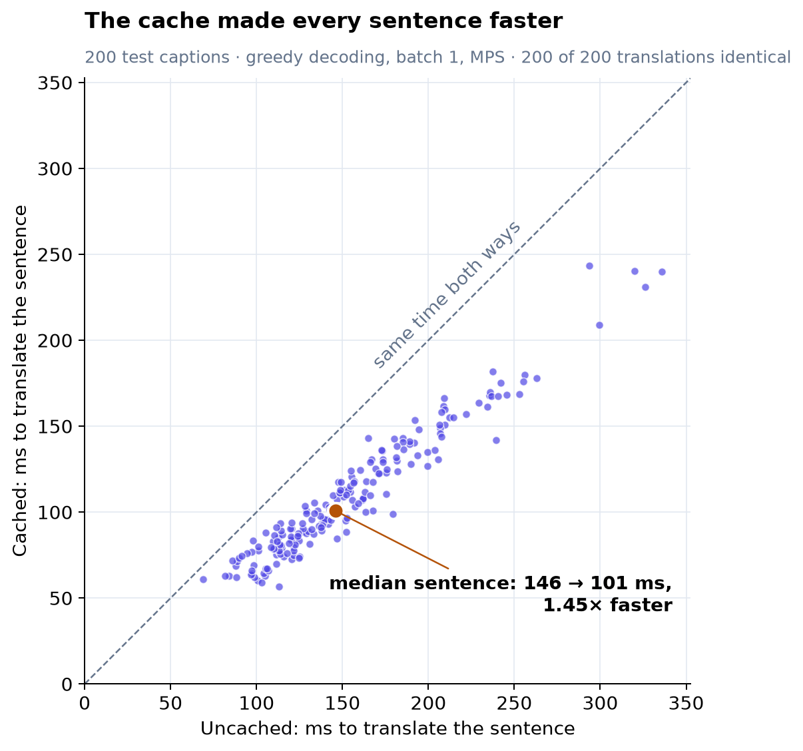
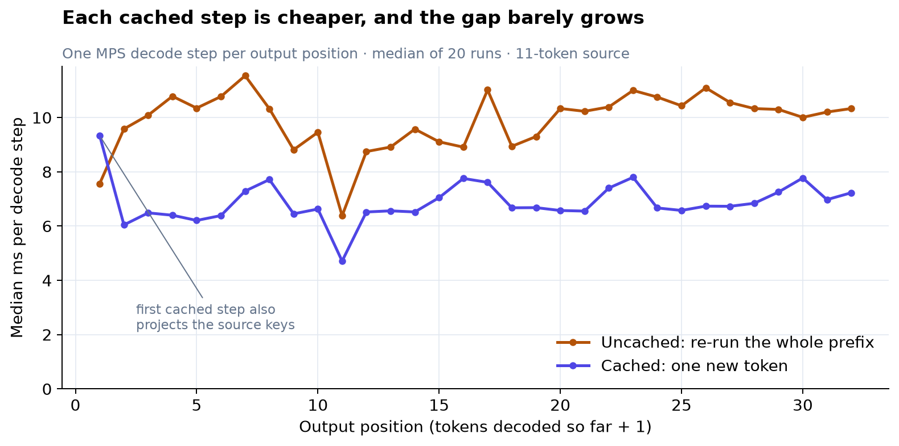

# KV caching in the Multi30k translator

A KV cache makes greedy translation about 1.45 times faster on MPS, and every
translation stays the same.

Greedy decoding writes one token per step. Without a cache, step t sends all t
tokens decoded so far back through every decoder block, recomputing keys and
values that did not change since the last step. With a cache, step t sends only
the newest token. Its self-attention reads the earlier keys and values from a
buffer, and its cross-attention reads the source's, projected once on the first
step.

## Where the cache lives

The decode loop owns the cache. `init_decoder_cache` in
[main.py](../../run/multi30k_translator/main.py) allocates one `DecoderBlockCache`
per decoder block, and `translate_with_cache` hands that list to `decode` at every
step. The model only writes into the buffers it receives, so the cache is state,
like `TrainState`.

Meta's Llama reference instead allocates `cache_k` and `cache_v` inside each
attention module, sized for a maximum batch and length. Whisper fills a dict keyed
by projection module through forward hooks. fairseq passes an `incremental_state`
dict and flags encoder attention as `static_kv`. Hugging Face passes one
`EncoderDecoderCache`, which each layer indexes by `layer_idx`.

Here one `KVCache` class serves both attentions. Its buffers start at full
capacity, and `length_filled` counts the rows holding keys; cross-attention is
filled once that count is nonzero. Whisper and fairseq grow the self-attention
cache with `torch.cat`, copying it every step. The caller also supplies each
token's position through `at_pos`, so the decoder keeps no position counter. The
[attention README](../../transformer/README.md#kv-cache) explains the layer side.

## Every sentence got faster



*Each point is one test caption, translated once each way. Points below the
dashed line took less time with the cache.*

| 200 test captions, MPS, batch 1 | Uncached | Cached |
|---|---|---|
| Median ms per sentence | 145.8 | 100.8 |
| Total seconds | 30.8 | 21.9 |
| Identical translations | 200 | 200 |

Speedups ranged from 1.13× to 1.99×. The median sentence's own ratio was 1.40×,
and the whole set ran 1.41× faster in total; the 1.45× above divides the two
median times. The points spread along the diagonal because a longer translation
takes more steps both ways.

## Per step, fixed overhead dominates



*One decode step at every output position for an 11-token source, median of 20
runs. Every step is forced, so positions past a real translation's end are
measured too.*

Uncached step time rises only from 7.6 to 10.3 ms over 32 positions, although
the last step sends 32 times as many tokens through the decoder as the first. At
this model size a fixed cost per step outweighs the extra arithmetic, so the
cache saves about the same 3.2 ms at every position (the median gap). The first
cached step also projects the source keys and values, which makes it the one step
slower than its uncached twin.

One decode allocates 384 KiB of self-attention cache and 132 KiB of
cross-attention cache for an 11-token source, matching
`2 × blocks × d_model × length × 4 bytes`.

## Data and method

[time_decoding.py](../../run/multi30k_translator/time_decoding.py) loads the best
translator checkpoint and its config, puts the model in eval mode, and times
three things on the device the checkpoint loads to:

1. End to end: `greedy_translate` and `translate_with_cache` each translate
   the first 200 English test captions, after a 10-sentence warm-up. The two
   alternate which runs first, so neither always gets the warmer device. Each
   row records both times and whether the two translations match.
1. Per step: one decode step at each of the 32 output positions, cached and
   uncached, fed `BOS_ID` so no step stops early at `EOS_ID`. Each position's
   time is the median of 20 runs.
1. Cache size: the bytes `init_decoder_cache` allocates, against the
   formula above.

Each timing synchronizes the device before and after, so it covers the queued
GPU work. All runs use batch 1 on Apple MPS; a larger batch or another device
moves the balance between overhead and arithmetic, so the 1.45× holds for this
setup only.

Download the [per-sentence timings](assets/kv_cache_timing/sentences.csv) and
[per-step timings](assets/kv_cache_timing/positions.csv) as CSV, or the figures
as SVG: [sentence latency](assets/kv_cache_timing/sentence_latency.svg) and
[step latency](assets/kv_cache_timing/step_latency.svg). Re-timing needs the best
checkpoint. The generator reads only the checked-in CSVs, so redrawing the
figures does not:

```bash
uv run python app/src/training/run/multi30k_translator/time_decoding.py
uv run python app/src/training/ablations/reports/generate_kv_cache_timing.py
```
