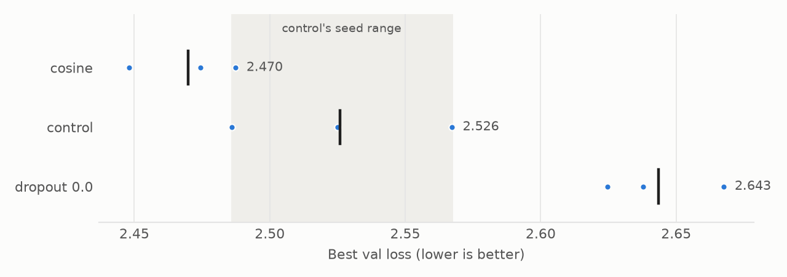

# Multi30k masked-token pretraining: dropout and LR decay at convergence

`Multi30kEnPredictor` is a pre-norm encoder trained with BERT-style masking on the
English side of Multi30k. This page records a 9-run ablation made on 2026-10-15 (3
arms, 3 seeds each, 100 epochs) that reruns two questions from the
[2026-09-29 study](../2026-09-29/README.md) at a length where training has stopped
improving. Every number below comes from [runs.csv](runs.csv) and
[epochs.csv](epochs.csv), exported from the runs' history files.

The short version: **once training runs long enough to converge, dropout earns its
place, and cosine decay probably does too.** Removing dropout cost 0.117, where at 50
epochs it cost 0.004. Cosine beat the constant learning rate by 0.056, which is
inside the control's unusually wide seed spread, so it is a strong lean rather than a
result.

**This page's losses do not compare with the 2026-09-29 page's.** That study's
tokenizer had 2,000 merges; this one's has 10,000. Val loss is a mean per masked BPE
token, and a token from a vocabulary five times larger is harder to predict, so every
loss here is about 0.45 higher for reasons that have nothing to do with the model.

______________________________________________________________________

## Results at a glance

| Arm | Params | Best val loss (mean of 3) | Seed range | Δ vs control | Best epochs | Masked-token accuracy |
|---|---|---|---|---|---|---|
| `schedule="cosine"` | 4.22M | 2.470 | 2.448–2.487 | −0.056 | 99, 93, 100 | 55.2% |
| **control** | **4.22M** | **2.526** | **2.486–2.567** | | **87, 87, 93** | **54.8%** |
| `dropout_rate=0.0` | 4.22M | 2.643 | 2.625–2.668 | +0.117 | 51, 52, 53 | 53.0% |

The control's three seeds span 0.081. That spread is the noise floor: a Δ inside it,
or an arm whose seed range overlaps the control's, is not a result.

- **The control converges between epochs 80 and 90.** Its best epochs are 87, 87, and
  93, and two of the three seeds end slightly above their best.
- **Dropout matters at convergence.** Without it the model peaks at epoch 51 to 53,
  then climbs. Its seed range sits entirely above the control's.
- **Cosine leads at every epoch past 40, but by less than the noise floor at its
  best.** Its worst seed and the control's best seed are 0.001 apart.
- **The constant-LR control's val loss is noisy, and cosine's isn't.** Late in the
  run the control moves about 0.015 from one epoch to the next; cosine moves 0.001.

______________________________________________________________________

## Setup

### Task and data

The loader, [multi30k.py](../../../app/src/training/dataload/multi30k.py), tokenizes
Multi30k's English sentences with the repo's byte-level BPE (10,000 merges, a
10,262-token vocabulary) and pads or truncates each to `seq_len=32`. It selects 15% of
the non-protected tokens for prediction and follows BERT's 80/10/10 rule: 80% become
`MASK_ID`, 10% become a random token, 10% stay unchanged.

- **Train:** 29,000 sentences, with masks redrawn every batch.
- **Val:** 1,014 sentences, masked with a fixed seed per sentence, so every run and
  every epoch scores the same 2,240 positions.
- **Loss:** cross-entropy over the selected positions only. Accuracy is top-1 over the
  same positions
  ([masked_token_metrics.py](../../../app/src/training/metrics/masked_token_metrics.py)).

The loader loads the default English merges file, which is now the translator's
tokenizer (`en/multi30k/merges_29000_20261012-154136.txt`), not the 2,000-merge file
the 2026-09-29 study used. Every run here shares it.

### Model

[multi30ken_predictor.py](../../../app/src/training/model/multi30ken_predictor.py):
token embedding, dropout, fixed sinusoidal positions, a stack of pre-norm
`EncoderBlock`s, a final LayerNorm, and a linear head to the vocabulary. The control is
the 2026-09-29 study's best setting: `d_model=128`, dropout 0.1, 6 blocks, 4 heads, an
FFN 6× `d_model` wide, QK norm on, and LayerNorm. The larger vocabulary nearly doubles
its parameters, from 2.16M to 4.22M; 2.64M of them are now the embedding and the head.

### Training

Adam at a peak learning rate of `1e-3`, batch size 64, no weight decay, 100 epochs.
`fit` steps the scheduler once per epoch, so the cosine arm's LR falls once per
epoch: to 0.52 × peak at epoch 50, 0.10 × at epoch 80, and 0.03 × at epoch 90. All
runs trained on an Apple-silicon GPU (MPS) at about 25 s per epoch, 6 hours 22
minutes of wall clock for the study. Every run drew its own train seed, recorded in
its history file.

______________________________________________________________________

## 1. Does the control converge?

The 2026-09-29 runs were all still improving at their last epoch, which made every Δ
there partly a measure of how far each arm had got. This study ran 100 epochs to avoid
that.

| Control seed | Mean val, epochs 41–50 | 71–80 | 81–90 | 91–100 | Best |
|---|---|---|---|---|---|
| `7f53e464` | 2.655 | 2.600 | 2.590 | 2.592 | 2.567 at 87 |
| `070e8a2d` | 2.662 | 2.562 | 2.558 | 2.561 | 2.525 at 87 |
| `c6a24ab1` | 2.638 | 2.553 | 2.525 | 2.523 | 2.486 at 93 |

- **Two seeds are flat from about epoch 80, and the third from about 90.** Over the
  last twenty epochs no seed improves its ten-epoch mean by more than 0.002.
- **The control is starting to overfit.** Its mean train/val gap grows every decade
  of epochs, from 0.48 at epoch 50 to 0.81 at epoch 100.

So 100 epochs is long enough for this model, and the Δs below measure the change, not
partial training.


______________________________________________________________________

## 2. Dropout

| Arm | Best val loss | Best epochs | Val at epoch 50 | Val at epoch 100 | Train at epoch 100 |
|---|---|---|---|---|---|
| control (0.1) | 2.526 | 87, 87, 93 | 2.634 | 2.566 | 1.754 |
| `dropout_rate=0.0` | 2.643 | 51, 52, 53 | 2.684 | 2.779 | 1.391 |

- **The 2026-09-29 verdict flips with length, as predicted.** There, at 50 epochs,
  removing dropout cost 0.004 and was not established. Here it costs 0.117 and no
  seed ranges overlap.
- **Without dropout the model stops learning at epoch 50 and starts memorizing.** Its
  val loss bottoms out at 51 to 53 and climbs to 2.78 by epoch 100, while its train
  loss keeps falling, to 1.39. The control's val loss keeps falling for another 35 to
  40 epochs.
- **It was already behind at epoch 50 this time** (+0.050 on the mean curve), where in
  the 2026-09-29 study it was level. The two runs differ in vocabulary as well as in
  seed, so this page doesn't try to explain the difference.

Train loss here is measured with dropout active, so the control's train loss is
inflated and the two arms' train losses don't compare directly.

______________________________________________________________________

## 3. Cosine decay

| Arm | Best val loss | Seed range | Best epochs | Mean val, epochs 91–100 | Epoch-to-epoch change, epochs 80–100 |
|---|---|---|---|---|---|
| control | 2.526 | 2.486–2.567 | 87, 87, 93 | 2.559 (2.523–2.592) | 0.015 |
| `schedule="cosine"` | 2.470 | 2.448–2.487 | 99, 93, 100 | 2.471 (2.449–2.489) | 0.001 |



- **Cosine leads, but not by enough to call.** −0.056 at the best epoch is less than
  the control's 0.081 spread, and the ranges meet: cosine's worst seed is 2.487, the
  control's best 2.486.
- **The two curves are identical until the decay bites.** At epoch 30, when the LR is
  still 81% of the peak, they are within 0.014. They separate after epoch 40, as the
  LR drops below about two thirds.
- **Best-epoch loss flatters the noisier arm.** The control's val loss jumps about
  0.015 between neighbouring epochs, so its best epoch is partly a lucky one. Cosine's
  barely moves at the end of its schedule, so its best epoch is close to its typical
  epoch. On the mean of the last ten epochs, cosine leads by 0.088 and the ranges
  don't overlap. That measure was chosen after seeing the data, so it supports the
  lean without establishing it.
- **The 2026-09-29 sweep's verdict on cosine reverses.** There, cosine lost all 14
  of its pairs at 20 epochs because the decay cut still-improving runs short. Run
  past convergence, the same schedule wins at every epoch after 40.

______________________________________________________________________

## Predictions against results

The predictions were written into the run plan before the runs started.

| Arm | Prediction | Result |
|---|---|---|
| control | Still improving at epoch 50, and flat well before 100 | Partly: improving at 50, but flat only from about epoch 80–90 |
| `dropout_rate=0.0` | Clearly worse at its best epoch, which comes far earlier than the control's | Confirmed: +0.117, best epoch 51–53 against 87–93 |
| `schedule="cosine"` | Better than the control by more than the noise floor | Not established: −0.056 against a 0.081 spread |

______________________________________________________________________

## What this doesn't show

- **The losses don't compare with the 2026-09-29 study's.** The vocabulary is five
  times larger, which raises the loss per token on its own. Only directions carry
  over: the dropout verdict and the cosine verdict, each compared within its own study.
- **The control's noise floor is wide.** 0.081 across three seeds is more than twice
  the translator ablation's. More seeds, or a smoother measure decided before the run,
  would settle cosine.
- **Warmup is untested here.** `warmup_cosine` and `one_cycle` were cut to fit the
  budget. The translator's scale study found that a warmup helps a model once it is
  wide enough, so it is worth testing on this model too.
- **Four component questions wait for a longer budget.** `qk_norm=False` (+0.095 at 50
  epochs in 2026-09-29), `final_norm=False`, `norm="rmsnorm"`, and
  `position_encoding=False` were cut from the plan. The model keeps every flag.
- **Post-norm is not an arm.** `EncoderBlock` hardcodes the pre-norm order, so testing
  it means changing shared code, not setting a flag.

______________________________________________________________________

## Next runs

In order of what they would settle:

1. **Cosine with more seeds**, or a measure such as the last ten epochs' mean written
   into the plan beforehand, to settle the −0.056.
1. **`final_norm=False` at 100 epochs**, the open component question.
1. **`warmup_cosine` against cosine**, to see whether a warmup adds anything on a model
   this narrow. On the translator it did nothing at 128 wide.

______________________________________________________________________

## Data and reproducing

### Files

- [runs.csv](runs.csv): one row per run (9 rows). It has the columns of the
  [2026-09-29 runs file](../2026-09-29/runs.csv), with `schedule` in place of
  `cosine_annealing`, plus `arm` (what differs from the control), `norm`,
  `position_encoding`, and `final_norm`.
- [epochs.csv](epochs.csv): one row per epoch per run (900 rows). It has train loss,
  val loss, val perplexity, val accuracy, and time per epoch. Join it to the runs file
  on `run_id`.
- `app/history/<run_id>.json`: the full history file for each run, with an attention
  capture per epoch under `app/history/attention_probes/<run_id>/`. These are gitignored
  and exist only on the machine that trained them. The history files don't record the
  config, so the `arm` column comes from the run log, which names each run's config
  next to its run id.

The `experiment` column is `ablation_100ep` for every run.

### Code

All 9 runs ran commit `82b8809` and record it. To rerun them, from the repo root:

```bash
caffeinate -is uv run python app/src/training/experiments/multi30ken_predictor_ablation.py
```

### Known issues in the recorded data

- **Epochs ran slower than planned.** The plan budgeted 18.7 s per epoch, the
  2026-09-29 figure, and the runs averaged 25 s, so the study took 6 hours 22 minutes
  rather than 5. Other applications were busy on the machine while it trained; that
  they caused the slowdown is likely but not confirmed.
