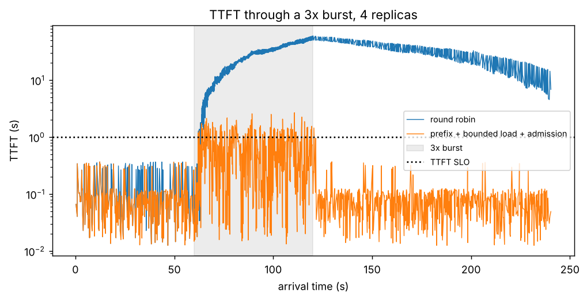

# T9: results

No GPUs or cluster here, so the policies were judged in a discrete-event simulation
of four identical replicas, driving the real `serve.router` policies, admission, the
canary controller, and the autoscaler. Command:
`uv run python app/src/training/experiments/serving_platform.py`.

**Model:** each replica runs 16 requests at once and queues the rest; prefill is 0.25 ms
per uncached prompt token, decode 30 ms per token; an LRU cache holds 6 system prompts
per replica. **Trace:** Poisson at 6 requests/s for 240 s, 3x faster from 60 s to
120 s; 30% of requests share one of 20 1,000-token system prompts; prompts 50-500
tokens, outputs 50-400. **SLO:** TTFT < 1 s (ITL is fixed at 30 ms < 60 ms). Cost: L4
at $0.7068/hour per replica.

## Routing policies, 3 seeds each ([policies.csv](policies.csv))

Mean, with the range over seeds:

| Policy | Goodput (req/s) | TTFT p99 | Prefix hit rate | Mean imbalance | Rejected | $/M output tokens |
|---|---|---|---|---|---|---|
| v0 round robin | 1.73 (1.68-1.80) | 59.6 s | 0.31 | 1.09 | 0 | 0.383 |
| v1 least outstanding | 1.74 (1.69-1.82) | 58.5 s | 0.31 | 1.02 | 0 | 0.383 |
| v2 power of two | 1.75 (1.71-1.82) | 58.6 s | 0.29 | 1.03 | 0 | 0.383 |
| v3 prefix + bounded load (1.25) | 1.81 (1.72-1.94) | 66.3 s | 0.90 | 1.19 | 0 | 0.383 |
| v4 v3 + admission control | 6.37 (6.28-6.55) | 1.9 s | 0.87 | 1.14 | 0.25 | 0.509 |

- **Least outstanding and power of two flatten load** (imbalance 1.09 to 1.02-1.03), but
  the burst exceeds total capacity, so no placement saves the tail: TTFT p99 near a
  minute for v0-v2.
- **Prefix routing triples the cache hit rate** (0.31 to 0.90) and stays inside its
  bound (mean imbalance 1.19 < 1.25). Its tail is slightly worse here: affinity keeps
  some requests on a busier replica.
- **Admission control is what holds the SLO under overload**: goodput 3.5x, p99 TTFT
  1.9 s, at the cost of rejecting a quarter of requests. $/M tokens rises because the
  same replicas serve fewer tokens; the tokens they do serve meet the SLO.

The burst plot ([burst.png](burst.png)) shows TTFT by arrival time: round robin climbs
past 50 s during the burst and takes two minutes to drain; with prefix routing and
admission, TTFT stays near the SLO through it.

## Two choices against one ([two_choices.csv](two_choices.csv))

10,000 requests into 100 replicas: one random choice puts at most 126 on a replica, the
better of two puts 102, against a mean of 100.

## Canary ([canary.csv](canary.csv))

A version whose TTFT is 1.5 s worse: rolled back at the 5% stage after 30 canary
requests (844 requests in total), all 30 of which missed the SLO. A healthy version
advances 5% to 25% to 100% (`test_canary.py`).

## Autoscaler ([autoscale.csv](autoscale.csv))

With the queue tripling at t = 60 s, `decide` asks for 12 replicas at once (enough to
bring waiting requests per replica under the threshold). With a cold node, the
scale-up legs are node 150 s, image 50 s, weights 7 s, warmup 33 s: capacity arrives at
t = 300 s, three minutes after a 60-second burst has ended. **The node leg dominates**;
with a warm node the image pull does. That is the case for pre-pulled images, warm
spare nodes, and admission control for the gap.

## Not run here

The same policies on four real vLLM replicas (GKE L4 or a 4x 4090 box), the measured
scale-up timeline, multi-LoRA with real adapters, and the llm-d comparison: all need
GPUs. The router (`Router.serve`), the rendered manifests, and the load generator are
ready for them.
