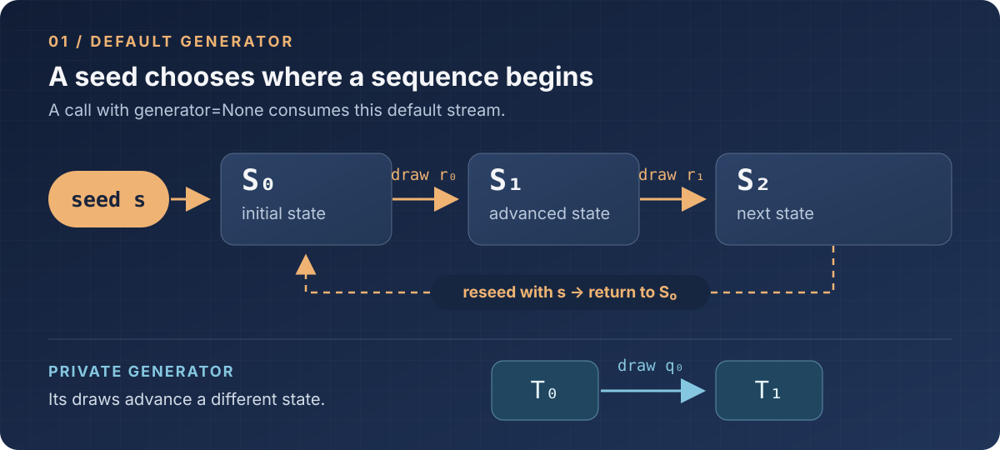

# Reproducing a training run

**To reproduce a run, restore the same random state and consume it in the same
order.**

Take two runs with the same model, configuration, and `train_seed`. In one,
insert `torch.rand(1, device="cpu")` just before `iter(train_loader)`. The
first batch can change. The loader now asks for its base seed after the CPU
generator has advanced; its sampler can shuffle differently. The optimizer
then sees a different sequence of batches.

## The generator has a position

A generator holds the state from which its next random value is computed. A
seed puts it at a known starting state. Each draw returns a value and advances
that state; reseeding returns it to the start. The seed tells us where the
sequence began. The calls made since then determine where it is now.

*A draw from the blue generator leaves the orange generator at its current
state.*

For example, `torch.rand(4, device="cpu")` uses the current process's default
CPU generator. Passing `generator=None` makes the same choice. Pass an
explicit `torch.Generator` and that object supplies the values instead,
without advancing the default.

## Why `train_seed` appears twice

In the [Multi30k entry point](../app/src/training/model/multi30ken_predictor.py),
Python's `random.getrandbits(32)` chooses `train_seed`. The entry point calls
`torch.manual_seed(train_seed)` immediately before constructing the model,
which fixes its initial weights for the same model configuration. At the start
of [`fit`](../app/src/training/train/train_loop.py), Dawnshard calls
`torch.manual_seed(train_seed)` again. Each call resets torch's default
generators, including the CPU stream the loaders later use.

The second call is deliberate. Model construction has already consumed random
values; training should not inherit whatever position that work left behind.
Resetting at `fit` means a new random initializer in the model cannot quietly
change the first epoch's shuffle.

*Orange traces the default torch state after `fit` resets it. Blue marks the
evaluation seeds bound to Multi30k's loaders.*

## The loader joins the same stream

Dawnshard does not pass `train_seed` into each loader. When `fit` iterates a
`DataLoader`, PyTorch draws a `base_seed` from the main process's CPU
generator. The sampler chooses shuffled indices in that process too. None of
the current loaders supplies a private `generator=`, so both choices depend
on the CPU state established at `fit`.

Worker processes begin from that loader seed: worker `i` receives
`base_seed + i` for its torch and Python RNGs, and PyTorch derives a NumPy
seed. [MNIST](../app/src/training/model/mnist.py) uses two workers. The
[AG News](../app/src/training/dataload/ag_news.py) and
[Multi30k](../app/src/training/dataload/multi30k.py) loaders use none, so
their collation runs in the main process. Changing the worker count changes
which process owns any random draw made during collation.

The worker derivation is covered in
[DataLoader seeding](../app/src/training/dataload/README.md#seeding) and the
[PyTorch DataLoader documentation](https://docs.pytorch.org/docs/stable/data.html#randomness-in-multi-process-data-loading).

## Validation needs a stable input

Multi30k masks tokens afresh during training. Its `_mlm_collate` passes
`generator=None` to torch's random operations, so a row can receive a
different mask on its next pass. That is dynamic masking.

Draw a fresh validation mask each epoch and the loss can move because the
masked positions changed, even if the model did not. The Multi30k loaders
remove that source of variation. They bind [`VAL_SEED = 1_000_000` and
`TEST_SEED = 2_000_000`](../app/src/training/constants.py) when they are
built. For row `i`, collation creates a private generator seeded with
`val_seed + i` or `test_seed + i`. The mask belongs to the row, regardless
of its batch or evaluation pass. This is static masking: validation loss can
be compared without adding variation from a newly drawn mask.

`fit` forwards `val_seed` to validation steps; it does not reset the default
torch generators with it. It records `test_seed` but runs no test pass. A
validation loader iterator still consumes a CPU `base_seed`, so changing
the validation schedule can shift later training draws from that stream.

## What a replay covers

Use the recorded `train_seed` with the same configuration, prepared data,
loader settings, and validation schedule. The two seed calls then recreate
the initial weights and the seeded training path. The
[history file](../app/src/training/train/train_loop.py) records the train,
validation, and test seeds for that purpose.

The seed cannot reach backward into data preparation. Multi30k currently
samples training rows before `train_seed` is chosen, so the recorded seed
cannot reconstruct that earlier sample. Retain the prepared rows or the inputs
that produced them. AG News has a separate data-sampling seed and cached rows.

Matching random choices does not by itself guarantee bitwise numerical
equality across devices or library versions. That requires a matching
environment and deterministic kernels; Dawnshard does not enable PyTorch's
deterministic-algorithm mode.

In short, the **global torch RNG** is the default state for a device in a
process; Python's `random` has its own. **Worker seeds** start process-local
streams. Multi30k uses the advancing default for **dynamic training masks**
and private, row-seeded generators for **static evaluation masks**.
The result is a training stream that can be replayed and an evaluation set
that asks the same question on every pass.
