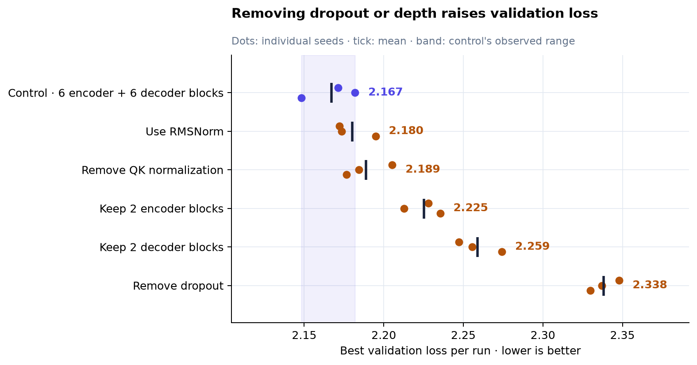
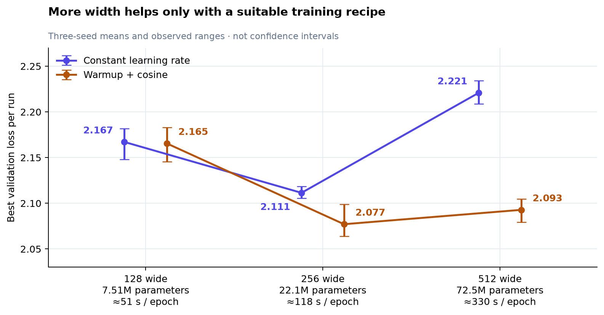
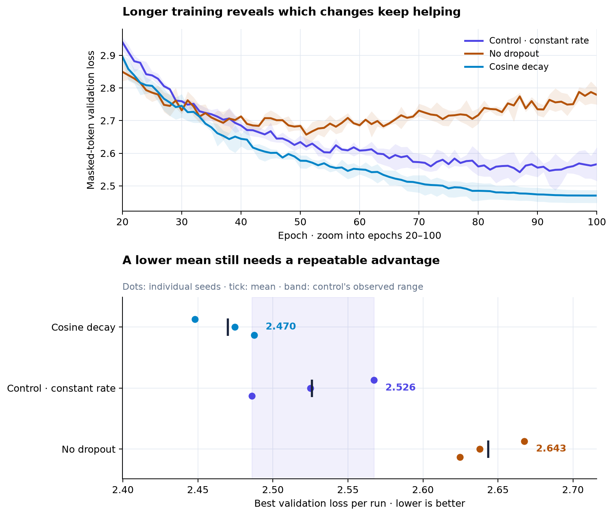
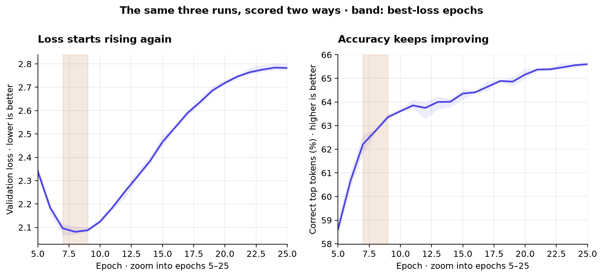

# What transformer ablations teach about training

A model can get better at its training examples while getting worse at new ones.
A larger model can lose to a smaller one until its learning rate changes. Reading
an ablation means understanding how those effects produce the final score.

These Multi30k experiments make that process visible. Start with the learning
curves, use controlled comparisons to explain what changed, and then check
whether the conclusion survives a different model size or training seed. The
examples below follow two tasks: English-to-German translation and predicting
hidden tokens in English captions.

## Compare one change against a control

An **ablation** tests what a component or training choice contributes by changing
it while holding the rest of the setup fixed. The **control** is the reference
configuration; an **arm** is one alternative. For example, comparing dropout 0.1
with dropout 0.0 asks what removing dropout does at that model size and learning
rate.

Training also contains randomness: weight initialization, batch order, and dropout
can change the result. Each arm therefore runs with **three independent training
seeds**. These are separate repeats, not matched pairs of runs with shared seeds.
A change that helps one run may disappear across repeats.

Both tasks use 29,000 training captions or caption pairs, sequences of up to
32 tokens, and byte-level BPE with 10,000 merges. What they predict differs:

- **The translator** reads an English caption and predicts each next German
  token. During evaluation it receives the *correct* German prefix. This is
  **teacher forcing**: it tests a prediction with the preceding answers supplied.
- **The masked-token model** reads an English caption with selected positions
  hidden or corrupted, then predicts the original tokens at those positions.
  Validation always scores the same selected positions.

Both report **cross-entropy loss**, which penalizes giving the correct token a
low probability. Lower is better. Because the tasks score different prediction
problems, their absolute losses do not rank the two models against each other.
The [tokenisation report](multi30k_tokenisation.md) explains another reason to
keep comparisons consistent: changing the tokenizer changes what a token means.

## Read the learning curve before choosing a budget

An **epoch** is one pass through the training data. Training loss measures the
examples used to update the weights; validation loss measures held-out examples.
When training loss keeps falling while validation loss rises, fitting the
training set more closely is no longer improving generalization. That pattern is
**overfitting**.


*The left panel is one translator pilot, separate from the comparison runs. The
right panel shows three-seed means; shading is the observed seed range. Training
uses dropout and validation disables it, so the vertical gap is not a pure
measure of generalization error. Follow how each curve changes over time.*

The translator's best validation loss is **2.178 at epoch 9**. By epoch 100 it is
**4.081**, even though training loss has fallen to **0.113**. Continuing that run
makes the training score look better while the held-out score deteriorates.
Saving the checkpoint with the lowest validation loss would retain the earlier
model.

The masked-token control follows a different trajectory. Its three best epochs
are **87, 87, and 93**; stopping it at epoch 30 would cut off a substantial part
of its improvement. The translator component study therefore uses 30 epochs,
its scale study 25, and the masked-token study 100. Every comparison run reaches
its recorded minimum within that budget, though some cosine runs reach it at the
very end, leaving improvement beyond 100 epochs untested.

Throughout the comparisons, **best validation loss** means: find each run's
minimum, then average those three minima. It is not the minimum of the mean
curve, and it is not the score at the final epoch. That distinction matters when
seeds reach their minima at different times.

## Dropout and depth solve different problems

Dropout randomly suppresses some activations during training. The model must
learn to predict under those perturbations rather than relying on every
activation always being available. Validation disables dropout. Its purpose is
to improve performance on new examples, even when it makes fitting the training
examples harder.

The width-128 translator's control uses dropout 0.1 and six blocks on each side.
The **encoder** builds a representation of the English input; the **decoder**
uses it and the German prefix to predict the next token. Depth counts how many
successive blocks transform those representations.



*Each dot is one run's minimum, the dark tick is the arm mean, and the shaded band
is the control's observed range, 2.148–2.182. Read each alternative against that
band. These ranges describe three runs; they are not confidence intervals.*

Removing dropout raises mean best loss from **2.167 to 2.338**, and every
no-dropout seed is worse than every control seed. It also moves the best epoch
from 8–9 to 5. By epoch 30 the no-dropout arm's mean validation loss has climbed
to **4.497**, against **2.985** for the control. Dropout both improves the best
checkpoint and slows the later deterioration.

Removing depth asks a different question: how much processing can this model
lose? Cutting the encoder from six blocks to two costs **0.058** loss; cutting
the decoder costs **0.092**. Both changes separate from the control's range.
The decoder cut hurts more on this teacher-forced prediction task. Decoded
translation quality could rank those choices differently.

The smaller effects are harder to resolve. **QK normalization** rescales attention
queries and keys before their dot products; removing it costs **0.022**.
**RMSNorm** is an alternative to LayerNorm that rescales activations without
subtracting their mean; switching to it costs **0.013**. Both ranges overlap the
control. These runs leave their benefit uncertain at width 128; they do not
establish that the choices are equivalent.

## Width and learning rate interact

**Width** is the size of each token's internal representation. A wider model has
more parameters, but those parameters still need an effective training recipe.
The **learning rate** scales the optimizer's updates; a schedule changes that
scale as training proceeds.



*Points show means of per-run minima; bars show observed seed ranges. The
English and German tokenizers are pinned across both translator studies.
Width 128 uses 30 epochs; widths 256 and 512 use 25, with schedules sized to those
budgets. Compare schedules at the same width first.*

At a constant learning rate of `0.001`, widening from 128 to 256 improves loss
from **2.167 to 2.111**. Widening again to 512 makes it worse: **2.221**.
Repeating the width comparison with warmup plus cosine changes the result. Its
benefit is only **0.002** at width 128, then **0.034** at 256 and **0.128** at
512\. A component that appears unhelpful in one setup can become useful when
another part of the setup changes. This is an **interaction**.

**Warmup** begins with small updates and increases their scale. **Cosine decay**
then reduces the rate smoothly toward zero. The next graph connects that recipe
to the wider model's validation trajectory.


*Left: learning rates reconstructed from the configured five-epoch warmup and
cosine schedule, stepped once per epoch. Right: recorded width-512 validation
losses, with three-seed means and observed ranges. The band marks the scheduled
runs' best epochs.*

The scheduled model initially improves more slowly, then reaches a better
minimum. Its best epochs occur while the rate is still **98–99% of its peak**.
That timing suggests the early training path matters, but the experiment changes
warmup and decay together. A cosine-only arm and a warmup-only arm at the same
width would separate their contributions.

The lowest mean loss is **2.077 at width 256 with warmup plus cosine**. Width
512 with the same recipe averages 2.093 and has an overlapping seed range, while
using **3.3× the parameters and 2.8× the time per epoch**. Width 256 is the more
economical candidate on this measure. Doubling depth to 12 encoder and 12 decoder
blocks also worsens loss at a constant rate, but that arm has no warmup run yet.
The result leaves the deeper model's response to a different recipe open.

## A late lead still needs repeatable seeds

In the masked-token task, dropout and decay play out over a much longer period.
Early in training the no-dropout model looks competitive. Later it stops
improving while the control continues downward. Cosine decay produces a smoother
late-training curve and the lowest mean minimum.



*Top: unsmoothed epoch-wise means, with observed seed ranges; the first 19 epochs
are omitted to make the late differences visible. Bottom: each run's own minimum
anywhere in its 100 epochs. A minimum of a noisy curve can look better than its
typical late-training value.*

Removing dropout raises mean best loss from **2.526 to 2.643**. Its best epochs
are **51–53**, much earlier than the control's **87–93**, and the two seed ranges
do not overlap. Dropout earns its place here too, but a short run would show less
of its benefit.

Cosine decay leads the control by **0.056**. Its worst seed scores **2.4874**,
while the control's best scores **2.4859**: the ranges narrowly overlap. Three
seeds give an encouraging direction without resolving how reliably it repeats.
Even separated observed ranges would remain limited evidence, rather than a
statistical significance test.

Averaging the final ten epochs gives a clearer separation, because it reduces the
influence of a single low point. That metric was chosen after viewing the
results. The useful next experiment fixes the metric in advance and adds seeds.
The earlier [September study](../experiments/multi30ken_predictor/2026-09-29/README.md)
also used a different tokenizer, so its reversal on decay cannot be attributed
to training length alone.

## Loss and accuracy reward different behavior

**Accuracy** asks whether the highest-probability token is correct. **Loss** asks
how much probability the model assigns to the correct token. They can move in
opposite directions because accuracy ignores most of the probability
distribution.

For one token, cross-entropy is `−ln(p)`, where `p` is the probability assigned
to the correct answer. Reducing that probability from 20% to 2% raises its loss
from **1.61 to 3.91**. Accuracy counts both predictions as wrong if another token
ranks first. A few increasingly confident errors can therefore outweigh gains
on other tokens in the average loss.



*Both panels score the same validation predictions. Shading around the curve is
the observed seed range; the vertical band marks the three runs' best-loss epochs,
7–9. Epochs 1–4 are omitted to show the later divergence.*

By loss, these runs favor an early checkpoint. By accuracy, they favor a later
one. Across model sizes, **width 512 with warmup plus cosine reaches 67.0% best
teacher-forced accuracy**, against **65.6% at width 256**, despite having a worse
mean best loss. “Best model” needs a named metric and a checkpoint-selection rule.

Neither metric evaluates complete generated translations. During decoding, an
early mistake becomes part of the prefix used for later predictions; teacher
forcing supplies the correct prefix instead. A held-out translation metric on
decoded outputs is the next check before choosing between the two sizes or
checkpoint rules.

## Turn the finding into the next experiment

The next run should change the factor that would resolve the current uncertainty.
For these studies, three comparisons follow directly:

1. **Separate warmup from decay at width 256.** Add cosine-only and warmup-only
   arms against the same control.
1. **Train the deeper translator with warmup.** Test whether its worse loss
   persists under the recipe that helped the wider model.
1. **Evaluate decoded translations from both checkpoint rules.** Compare the
   best-loss and best-accuracy checkpoints on a held-out translation metric.

For masked-token decay, add seeds and decide in advance whether the target is
best-checkpoint loss or average late-training performance. Each question needs
its own measurement.

## Data and reproduction

The report uses **66 comparison runs, 22 arms, and three independent training
seeds per arm**, completed October 13–15, 2026. The separate 100-epoch translator
pilot supplies the first learning curve and is excluded from those counts.

| Study | Comparison runs | Budget | Run-level data | Per-epoch data |
|---|---|---|---|---|
| [Translator components](../experiments/multi30k_translator/2026-10-13/README.md) | 30 · 10 arms | 30 epochs | [31 runs including the pilot](../experiments/multi30k_translator/2026-10-13/runs.csv) | [1,000 epochs](../experiments/multi30k_translator/2026-10-13/epochs.csv) |
| [Translator scale](../experiments/multi30k_translator/2026-10-15/README.md) | 27 · 9 arms | 25 epochs | [27 runs](../experiments/multi30k_translator/2026-10-15/runs.csv) | [675 epochs](../experiments/multi30k_translator/2026-10-15/epochs.csv) |
| [Masked-token convergence](../experiments/multi30ken_predictor/2026-10-15/README.md) | 9 · 3 arms | 100 epochs | [9 runs](../experiments/multi30ken_predictor/2026-10-15/runs.csv) | [900 epochs](../experiments/multi30ken_predictor/2026-10-15/epochs.csv) |

The [summary CSV](assets/multi30k_ablations/summary.csv) contains all 22 arms,
including comparisons omitted from the figures. The Czech-to-German arm changes
the relationship between source and target captions as well as the source
language; see the [source-language discussion](../experiments/multi30k_translator/2026-10-13/README.md#source-language)
before interpreting its loss gap.

Download the figures as SVG:
[training curves](assets/multi30k_ablations/training_budget.svg),
[components](assets/multi30k_ablations/translator_components.svg),
[width and schedule](assets/multi30k_ablations/width_and_schedule.svg),
[schedule dynamics](assets/multi30k_ablations/schedule_dynamics.svg),
[masked-token convergence](assets/multi30k_ablations/masked_token_convergence.svg),
and [loss versus accuracy](assets/multi30k_ablations/loss_and_accuracy.svg).

Rebuild the summary and all six figures from checked-in data, without retraining
or downloading anything:

```bash
uv run python reports/generate_multi30k_ablations.py
```

The [generator](generate_multi30k_ablations.py) checks comparison runs against
their complete epoch records and confirms three distinct seeds per arm. The
linked study records retain configurations, recorded commits, rerun commands,
and the full result tables.
