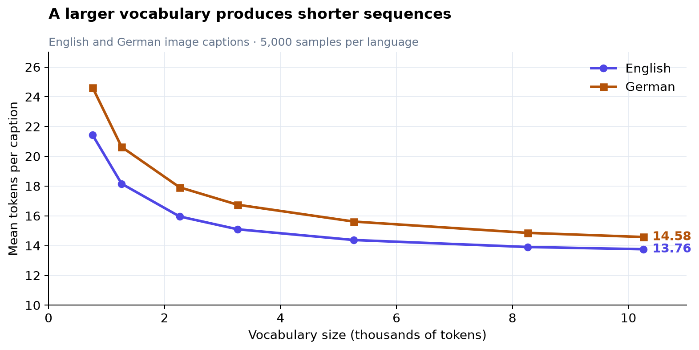
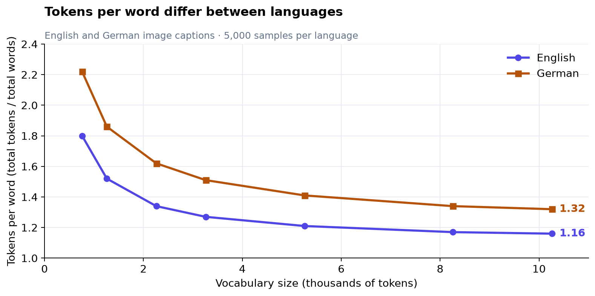
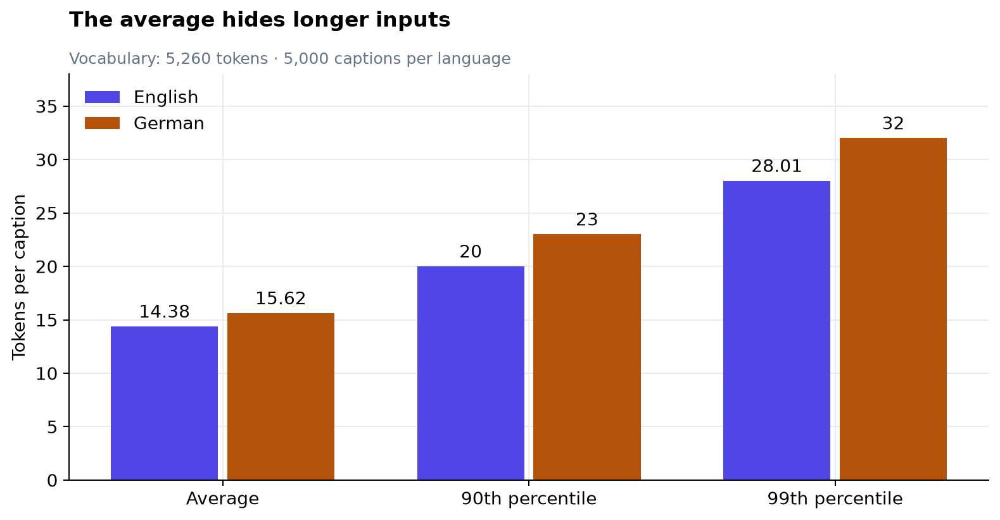

# Token counts measure the tokenizer, too

The same text can become different numbers of tokens. That makes a token count a
property of both the text and the tokenizer. To understand how much text fits in
a context window, you need to know how that tokenizer divides it.

## A bigger vocabulary buys shorter sequences

Byte Pair Encoding (BPE) builds a vocabulary by repeatedly joining frequent
adjacent pieces of text. A word that needs several tokens with a small vocabulary
may fit into one with a larger vocabulary. More entries let frequent text
patterns use fewer positions.



*The same captions were tokenised at each vocabulary size within each language.
Each point summarises 5,000 captions.*

Increasing the vocabulary from roughly 760 to 5,260 entries reduces average
caption length by **33% for English and 37% for German**. Increasing it again to
10,260 saves only another **4% and 7%**. The early merges capture frequent
patterns; later additions offer progressively smaller gains in this sample.

This is the tradeoff: a small vocabulary uses more positions to express the text;
a large vocabulary has more entries to store and learn. The flattening curves
show why vocabulary size is a choice to measure, rather than simply maximise.

## A word-to-token ratio travels poorly



*The ratio counts total tokens divided by total whitespace-separated words.*

At a vocabulary size of 5,260, these captions average **1.21 tokens per word in English
and 1.41 in German**, counting punctuation as tokens too. Both tokenizers have
the same vocabulary size, yet they divide their respective text differently.
The gap describes this dataset and these tokenizers; it is not a universal
conversion rate for either language.

When estimating context capacity or choosing document chunk sizes, count with
the tokenizer you will actually use. Measure representative text in each
language. A fixed word-to-token shortcut can hide both vocabulary choices and
language differences.

## Averages hide longer inputs



*The 99th percentile describes the length at or below which roughly 99% of
sampled captions fall.*

German captions average about **16 tokens**, but their 99th-percentile length is
**32**. A limit chosen from the average would cut off longer inputs. Use upper
percentiles to understand how much text a proposed limit would exclude.

## Data and method

The [Multi30k notebook](../notebooks/multi30k_dataload.ipynb) trains separate
English and German byte-level BPE tokenizers on the training captions, at seven
merge budgets from 500 to 10,000. It measures 5,000 sampled training captions per
language, reusing that language's sample across all seven budgets. The English
and German samples are drawn independently, so these are not paired-caption
comparisons. The results describe compression on training text, not performance
on unseen text.

Vocabulary sizes retain the notebook's recorded layout: 256 byte tokens, four
protected token IDs, and the learned merges. The current
[tokenizer](../app/src/training/common/README.md) reserves six protected IDs,
including beginning and end tokens for translation. That changes a 5,000-merge
vocabulary from 5,260 to 5,262 entries; the charts preserve the saved measurements.

Download the [statistics as CSV](assets/multi30k_tokenisation/stats.csv) or the
figures as SVG:
[caption lengths](assets/multi30k_tokenisation/mean_length.svg),
[tokens per word](assets/multi30k_tokenisation/tokens_per_word.svg), and
[length percentiles](assets/multi30k_tokenisation/length_tail.svg).
The [report generator](generate_multi30k_tokenisation.py) exports these assets
from saved notebook output without downloading data or retraining tokenizers:

```bash
uv run python reports/generate_multi30k_tokenisation.py
```
